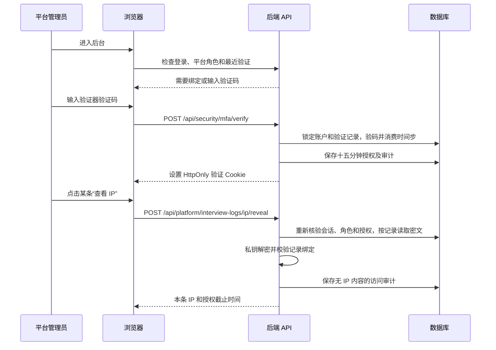

# IP 加密、后台 2FA 和点击解密：技术实施与上线说明

日期：2026-10-16。本文覆盖当前实现，取代此前的全量敏感字段和音视频改造草案。

## 1. 范围与设计

复用现有 TanStack Start 页面、Hono 后端、Better Auth 登录和 PostgreSQL。只新增字段加密和平台后台验证模块，无独立管理产品或新部署服务。

- IP：应用层非对称信封加密，使用 `jose` 的 JWE `RSA-OAEP-256` + `A256GCM`。RSA 至少 3072 位。
- 2FA：Better Auth 继续负责第一因素和登录会话；平台后台单独使用 `otplib` 验证 TOTP。没有启用会改变普通登录流程的 Better Auth 全站 two-factor 插件。
- 二次授权：服务端数据库记录 + 独立 HttpOnly Cookie，绑定用户和登录会话，按最后一次后台操作维持十五分钟。前台活动滑动续期，后台轮询不续期。
- 解密：专用 POST 接口只接受记录引用，服务器读取密文、检查权限、解密、写审计，然后返回一条 IP。
- 普通业务、音视频文件、截图文件、公开/工作区录制链接维持现有流程。媒体环境 JSON 中的 IP 副本纳入本期加密。

## 2. 数据流



授权过期返回 `MFA_REQUIRED`；尚未绑定返回 `MFA_ENROLLMENT_REQUIRED`。浏览器弹出验证表单，成功后只重试当前 IP 读取一次。取消、验证失败、角色不足或第二次请求仍失败时不循环重试。其他后台写操作不自动重放。

## 3. IP 存储与读取

| 位置 | 存储方式 | 普通接口行为 |
| --- | --- | --- |
| `interview_telemetry_event.ip` | `ip:v1:` 前缀的 JWE | 删除 `ip` 与 `ipLookupHash`，返回 `hasIp` |
| `candidate_entry_credential_use.ip` | 相同版本的 JWE | 返回 `hasIp`，不返回 IP 内容 |
| `interview_media_asset.environment.ip` | 绑定媒体记录的 JWE 快照 | 返回 `environment.hasIp` |
| `session.ip_ciphertext` | 绑定用户和会话令牌摘要的 JWE | Better Auth 字段设为 `input: false, returned: false` |
| `session.ip_address` | 新会话始终为空；历史值需迁移 | 不返回历史明文的前提是上线前完成转换 |

密文内部同时保存环境命名空间、实体类型、工作区/用户、记录 ID 和字段用途。不能把另一条记录的密文复制过来直接解密。相同 IP 多次保存得到不同密文。

媒体采样进程使用公钥将来源日志密文连同其原始绑定再次封装，外层绑定媒体记录。无需私钥，也不依赖原日志永久存在。对尚未迁移的旧日志，采样写入时直接加密该原始 IP。媒体文件字节、播放接口和存储策略不变。

保留精确 IP 搜索：`ip_lookup_hash = HMAC-SHA256(独立索引密钥, 规范化 IP)`。IPv6 做规范化。索引不返回客户端；同一个 IP 产生相同索引，保留相等关系。索引密钥泄漏后 IPv4 可被枚举，因此不能把该索引视为匿名化结果。

前端搜索改为 POST JSON，避免把 IP 放入 URL。旧 GET 查询入口用于兼容无 IP 查询。日志系统、代理/APM 必须关闭这些敏感接口的请求/响应正文采集。

## 4. 2FA 状态、表与限制

| 数据表 | 用途 |
| --- | --- |
| `platform_mfa_factor` | 每个平台管理员一个 TOTP 因素；加密密钥、首次绑定会话/期限、待确认的新密钥及其会话/期限、已消费时间步、恢复码摘要、错误计数与锁定期限 |
| `platform_mfa_grant` | 会话绑定的授权，保存验证 Cookie 的 SHA-256 摘要、验证时间、截止时间 |
| `platform_security_audit` | 绑定、验证、解密、人工重置的操作审计；无 IP、验证码、密钥、恢复码或密文内容 |

TOTP 为六位数字、三十秒周期，接受前后一个周期的时钟偏差。验证使用库提供的 `afterTimeStep`，在数据库行锁下消费时间步。新代码的前导零保留；不把验证码转为数字。

首次绑定要求真实平台管理员、有效且非模拟身份的登录会话。在后台入口直接生成绑定二维码，不要求退出重新登录。绑定请求仅生成未激活因素；输入正确验证码后才激活，生成十个 128 位随机恢复码，服务端只保存绑定用户的摘要。临时绑定在十分钟后过期；同一会话在有效期内重复加载二维码返回同一未确认密钥，避免重复请求造成二维码失效。

绑定记录按平台用户 ID 保存，独立于 Google、飞书或密码这些登录入口。首次绑定成功后，退出再登录或十五分钟授权过期，都只需重新输入验证码，不需要重新扫码绑定。普通业务账号的登录不强制绑定；后台入口、后台操作和 IP 查看仍在服务端检查权限。本地与线上使用独立数据库时，绑定记录也各自独立。

验证入口统一为 `/platform/verify?returnTo=...`。父路由 `beforeLoad` 每次导航检查服务端状态；授权缺失或过期则跳转，后台子页面的数据加载也保留权限检查。返回地址只允许平台内路径，拒绝外部地址和验证页自身。

首次绑定保存恢复码后，入口使用 `await router.invalidate({ forcePending: true, sync: true })` 同步重新加载后台权限，再导航回原页面。完成前显示等待状态，失败时保留恢复码并显示错误。服务端授权已有效但页面状态过旧时直接继续，不再次要求输入验证码。

`PlatformSessionGuard` 捕获鼠标、键盘、点击、提交和滚动活动，最多每分钟上报一次最后活动时间。活动接口只更新仍有效且匹配当前用户、会话和 Cookie 的授权；活动时间上限为服务器当前时间，乱序请求不缩短期限，已过期授权不能恢复。响应刷新 HttpOnly Cookie 的剩余有效期，不返回令牌。普通读取、轮询和仅切回标签页不续期。

计时到期立即隐藏后台内容并导航到验证页；休眠后点击时，在业务回调前再次检查期限。RPC、文件读取和 Better Auth 客户端使用统一请求封装，收到 `MFA_REQUIRED` 或 `MFA_ENROLLMENT_REQUIRED` 时统一导航。普通权限拒绝与验证码输入错误沿用原处理。切回标签页查询服务端状态以发现授权撤销。验证完成只返回原页面，不自动重放修改或 IP 解密操作。

后台“后台两步验证”设置页位于 `/platform/security`。更换验证器要求当前后台授权有效；待确认的新密钥另存为 `pending_secret`，绑定当前会话并在十分钟后过期，旧因素继续工作。确认新验证码后，在一个事务中替换因素、生成新恢复码、撤销该用户所有后台授权并重新授权当前会话。取消或失败不会替换旧因素，错误计数沿用同一个账户锁定策略。

五分钟内五次错误会锁定十五分钟。错误计数在事务提交后再抛业务错误，不能因为验证失败回滚计数。成功验证清空计数。恢复码和 TOTP 使用同一限流记录，重复恢复码在并发请求中最多成功一次。

授权 Cookie：生产环境名 `__Host-arc-admin-mfa`，开发环境名 `arc-admin-mfa`；`HttpOnly`、生产 `Secure`、`SameSite=Strict`、`Path=/`、十五分钟。服务器同时验证原 Better Auth 会话、最新用户角色/封禁状态、因素已激活、授权 Cookie 摘要和授权截止时间。仅有 `enrolled=true` 或前端状态不能获得解密能力。

登出/撤销会话通过外键删除授权；角色降级或封禁时撤销授权，检查本身也重新读取数据库角色。模拟身份会话不能绑定或获得授权。管理员因素重置撤销全部登录会话和授权。

## 5. 接口与页面边界

| 方法与路径 | 行为 |
| --- | --- |
| `GET /api/security/mfa` | 已登录的平台管理员查看自己的绑定和授权状态 |
| `POST /api/security/mfa/activity` | `{activeAt: number}` 毫秒时间戳；仅为尚有效授权续期，并刷新 HttpOnly Cookie |
| `POST /api/security/mfa/enroll` | 开始首次绑定，返回当前绑定二维码 URI/手动密钥 |
| `POST /api/security/mfa/verify` | `{method: "totp" 或 "recovery", code: string}`；成功设置 Cookie |
| `POST /api/security/mfa/replacement` | 要求有效后台授权，开始更换验证器；旧因素继续有效 |
| `POST /api/security/mfa/replacement/verify` | `{code: string}`；确认新验证器、更新恢复码并重新设置当前授权 Cookie |
| `POST /api/platform/interview-logs/ip/reveal` | `{kind: "telemetry" 或 "entry-use" 或 "media", id, meetingId}`；只允许服务器选择的记录密文 |
| `POST /api/platform/interview-logs/search` | 会议列表查询，含 IP 精确搜索 |
| `POST /api/platform/interview-logs/:meetingId/search` | 单场日志查询 |

新增验证接口在 Platform MFA 中间件之外，但自身要求平台管理员，避免首次绑定被后台守卫拦住。写请求严格比对配置的 `BETTER_AUTH_URL` origin；非法或缺失 Origin 拒绝。

防护同时覆盖：

1. `/api/platform/**` Hono 根路由中间件。
2. TanStack 平台后台 SSR/server function 的公共权限函数；未验证时不读取受保护页面数据。
3. Better Auth `/api/auth/admin/**` 的服务端 before hook，防止绕过 Platform 接口调整账号和角色。
4. 单条 IP 接口及其 DAO 再次检查授权；客户端不能提交任意密文或任意解密算法。

平台管理员本来具有跨工作区排障权限。工作区 owner/admin 不等于平台管理员。解密记录必须匹配提交的会议 ID，工作区和加密上下文从数据库取得。

列表和解密响应均禁用 HTTP 缓存。解密返回的 IP 只保存在查看组件的短期状态，不放入 TanStack Query、localStorage、sessionStorage 或全局状态，也不自动复制到筛选条件。自动隐藏时间为一分钟与授权截止时间二者的较早值；后台标签页、页面离开、记录切换时清除。管理员手动输入的 IP 搜索条件沿用页面筛选状态和查询缓存，不适用查看组件的一分钟清除规则；请求使用 POST，不写入 URL。

## 6. 代码入口

| 模块 | 位置（相对于仓库根目录） |
| --- | --- |
| IP 加密/上下文/索引 | `apps/ai-recruitment-copilot-backend/src/lib/server/ip-encryption.ts` |
| 登录会话与原生管理员接口保护 | `apps/ai-recruitment-copilot-backend/src/lib/server/auth.ts` |
| 2FA 服务与 API | `apps/ai-recruitment-copilot-backend/src/server/routes/security/` |
| 后台中间件 | `apps/ai-recruitment-copilot-backend/src/server/middlewares/platform-mfa.ts` |
| 解密 API | `apps/ai-recruitment-copilot-backend/src/server/routes/platform/routes/interview-logs/routes/ip/` |
| 页面验证与 IP 查看组件 | `apps/ai-recruitment-copilot/src/components/features/platform/security/` |
| 共享请求类型 | `packages/shared/src/platform-security.ts` |
| 表结构 | `packages/db-schema/src/schema.ts` |
| 结构迁移 | `apps/ai-recruitment-copilot/drizzle/20261016120000_platform_mfa_ip_encryption/migration.sql` |
| 更换验证器字段迁移 | `apps/ai-recruitment-copilot/drizzle/20261016170000_platform_mfa_replacement/migration.sql` |

## 7. 部署配置

Web 挂载后端和 standalone Hono 都使用相同实现。负责 API 的运行环境配置以下值；真实密钥存于部署密钥管理器，不提交 Git、不写日志、不放入浏览器公开环境变量。

| 变量 | 内容与分配 |
| --- | --- |
| `IP_ENCRYPTION_CONTEXT` | 固定环境命名空间，例如 `arc-production`；已有密文后不可随意改动 |
| `IP_ENCRYPTION_KEY_ID` | 固定的密钥版本标识；已有密文后不可直接替换 |
| `IP_ENCRYPTION_PUBLIC_KEY` | RSA 至少 3072 位的 SPKI PEM，整体 Base64；API、历史迁移程序和媒体采样 Worker 需要 |
| `IP_ENCRYPTION_PRIVATE_KEY` | 对应 PKCS8 PEM，整体 Base64；只有提供 IP 解密的 API 进程需要 |
| `IP_LOOKUP_KEY` | 独立随机 32 字节，Base64；日志写入和精确搜索需要 |
| `ADMIN_MFA_KEY` | 另一份独立随机 32 字节，Base64；AES-256-GCM 保护 TOTP 密钥 |
| `BETTER_AUTH_URL` | 真实外部 origin，供登录与新增 POST 接口来源检查 |

IP 采集不再依赖 `INTERVIEW_TELEMETRY_IP_HEADER` 配置。2026-10-19 补齐反代/直连处理：Web、独立 Backend 与本地 Vite 均传入实际连接 IP，只有连接来自 `INTERVIEW_TELEMETRY_TRUSTED_PROXIES` 配置的 IP/CIDR 时才优先读取有效 `X-Real-IP`，再尝试 `X-Forwarded-For` 第一个地址。其余情况回退实际连接 IP，运行时没有连接信息才记录未采集。可信代理必须覆盖这两个头；发布前须配置反代对端，详见 ADR 0020。IP 继续加密入库，历史缺失值不以当前 IP 补写。

验证器密钥、IP 私钥、索引密钥和 Better Auth 登录密钥分开保存。不能从密码或其他字段派生这些密钥。测试生成的密钥只在内存存在，不可用于部署。

本期只支持一个 IP 密钥版本。轮换前需要设计并演练旧密钥读取与重新加密；不能直接覆盖变量，否则旧记录无法读取。MFA 密钥替换也必须安排管理员重新绑定或迁移因素。必须备份密钥并限制获取权限。

## 8. 上线和历史数据转换

建议维护窗口发布，避免旧实例继续写明文：

1. 确认目标环境和数据库，备份数据库及密钥；暂停旧 API/相关 Worker 的写入。
2. 通过项目现有发布流程执行新增结构迁移；这里只增表/列，不在 SQL 内放密钥。
3. 向新 API 和需要公钥的 Worker 注入配置。先在测试环境确认公私钥匹配、验证码时间同步。
4. 用下面命令只读统计历史明文；检查目标数据库来自部署环境配置。脚本沿用仓库 `loadStandaloneEnv`，本地环境文件优先顺序见该实现，正式环境建议明确注入变量。

```sh
pnpm --filter @arc/ai-recruitment-copilot-backend security:backfill-ips
```

5. 在已确认的目标环境执行转换，脚本分批处理，按旧值条件更新，可重复运行，输出只有剩余行数。遇到非法数据/缺密钥/孤立媒体档案时停止并返回失败，不记录原始 IP。

```sh
pnpm --filter @arc/ai-recruitment-copilot-backend security:backfill-ips --apply
```

6. 再次只读统计，四类剩余明文均应为零；按授权解密抽样核对。旧备份、WAL/副本、反向代理/CDN/APM 的历史明文不由本脚本清除，按访问和保留策略处理。
7. 启动新版实例；管理员首次绑定、保存恢复码；验证登录、后台入口、IP 点击查看及正常音视频业务。
8. 未完成密钥配置和历史转换前不得宣布“已经全部加密”。缺密钥时新 IP 写入/解密失败关闭，绝不回退明文。

回滚应使用兼容新加密格式的版本。直接恢复旧应用会再次写明文，也可能把密文当 IP 展示；不要通过批量解密恢复明文来回滚。

### 8.1 本地 `make dev` 的准备与本次修复

`make dev` 启动 Web、语音 Agent 和异步 Worker，不自动执行数据库迁移或生成加密密钥。更新到这版代码后，先按第 7 节配置开发环境自己的六项安全变量，再执行结构迁移及第 8 节的历史转换，最后启动应用。出现 `column "ip_ciphertext" does not exist` 表示运行代码已经更新、连接的数据库结构尚未更新；重登或清理前端缓存不能补齐该字段。

本次已在开发机本地 `127.0.0.1:54324/ai_recruitment` 完成初始化：

- 备份本地数据库及原 Web `.env`，生成本地专用密钥并保存独立副本；文件位于 Git 忽略的 `.devtools/security-local/2026-10-16T08-30-59.471Z/`，权限仅限当前用户。保留本地加密数据库时，也必须保留对应密钥。
- 执行 `pnpm db:migrate`，唯一待执行项为 `20261016120000_platform_mfa_ip_encryption`，迁移已完成。
- 后续为后台验证器设置新增 `20261016170000_platform_mfa_replacement`；本地同样已经执行，只新增三个待确认字段，保留已有绑定和授权。
- 执行历史转换：371 条会话、178 条日志和 18 条媒体环境 IP 完成加密；入场记录无待转换项，四类明文剩余均为零。抽样解密及本地 MFA 密钥加解密验证通过。
- 将本地 `NEXT_PUBLIC_ENABLE_GOOGLE_LOGIN` 设为 `true`。本地登录页此前因该开关为 `false` 显示飞书入口，而现有账号使用 Google/密码；现已确认 `/login` 返回 200 并显示 Google 与账号密码入口。

初始化脚本不代替管理员本人扫码绑定。本地已有管理员本人完成的绑定记录，后续结构迁移和回调修复保留该记录。Google 登录是账号认证，Google Authenticator 是生成六位验证码的手机验证器，两者的状态不能互相替代。以上本地操作不代表线上已部署或线上数据已转换。

## 9. 验证器恢复

先使用未消费的恢复码。全部丢失时，维护人员在独立可信渠道核实身份，再执行：

```sh
pnpm --filter @arc/ai-recruitment-copilot-backend security:reset-mfa --user-id=目标用户ID --operator=维护人员标识 --apply
```

该工具在一个事务中删除目标因素、后台授权和所有登录会话，并写重置审计。用户需重新登录绑定。工具不通过网页暴露；账号密码本身不能关闭 MFA。

## 10. 验收要求

- 随机化加密、密文篡改、错误工作区/记录绑定、无私钥写入与媒体副本保留。
- IP 历史转换幂等、四类存储无明文、索引精确搜索与 IPv6 规范化。
- 列表、媒体环境和 Better Auth 会话 API 均无 IP 明文、密文及搜索索引泄漏。
- 首次绑定确认、过期绑定、已有有效登录直接绑定、六位验证码前导零。
- 同一验证码不可重放；并发恢复码只能消费一次；失败计数持久化和临时锁定。
- 授权只属于当前用户/会话，独立 Cookie 必须匹配；用户活动续期，纯查询和轮询不续期；乱序与未来活动时间不突破服务端期限，过期授权不能恢复。
- 未登录、普通用户、工作区管理员、封禁、角色撤销、会话注销、模拟身份被拒绝。
- 后台 API、原生 Better Auth admin API、SSR/server functions 均受保护；POST 来源检查有效。
- 列表不预解密；点击触发单条读取；授权过期统一导航验证页，返回后需再次点击，不自动重放；自动清除明文。
- 超时立即隐藏页面；休眠后点击不执行原按钮回调；RPC、媒体和 Better Auth admin 请求失效时统一导航；验证页不会重定向自身。
- 绑定完成的回调等待路由刷新；刷新失败保留恢复码；页面状态过期而服务端授权有效时直接继续。
- 更换验证器确认前保留旧因素，确认后撤销旧恢复码及其他会话后台授权；过期更换、跨会话提交和错误验证码被拒绝。
- 正常业务页面、音视频播放和现有文件链接不因字段改造发生格式变化。

自动化验证使用隔离的 PGlite PostgreSQL 和临时测试密钥，另有前端交互测试及两端类型检查。生产 PostgreSQL 多实例并发、TLS/代理/Cookie、手机验证器扫码以及实际部署的媒体 Worker 需要环境验收。本地自动化不能替代这些检查。

## 11. 验证记录

2026-10-16 首轮本地完成以下检查（活动续期追加验证见下文）：

| 检查 | 结果与范围 |
| --- | --- |
| 后端定向测试 | 8 个文件、35 个用例通过；覆盖普通账号免绑后台验证器、加密、实际登录会话序列化、MFA 服务和 HTTP Cookie、后台权限、更换验证器、显式解密、历史转换、日志与媒体路由 |
| 前端定向测试 | 5 个文件、17 个用例通过；覆盖验证码前导零、恢复码、入口直接绑定、回调等待真实路由刷新、旧页面恢复、设置内更换验证器、取消后不继续读取、IP 显式查看和自动隐藏、现有日志/媒体界面 |
| 类型检查 | Web、Backend、`@arc/shared`、`@arc/db-schema` 通过 |
| 定向静态检查 | 本次修改的 62 个 TypeScript/TSX/JSON 文件通过 Ultracite 格式与 lint 检查，自动生成的路由树单独由 Router 插件更新 |
| 差异检查 | `git diff --check` 通过 |

复核命令（仓库根目录执行）：

```sh
pnpm --filter @arc/ai-recruitment-copilot-backend test src/lib/server/auth-security.test.ts src/lib/server/ip-encryption.test.ts src/server/routes/security/mfa/crypto.test.ts src/server/routes/security/mfa/flow.test.ts src/server/routes/platform/routes/interview-logs/route.test.ts src/server/routes/platform/routes/interview-logs/routes/media/route.test.ts src/server/routes/public/routes/interview-telemetry/route.test.ts src/server/routes/platform/__tests__/queue-route.test.ts
pnpm --filter @arc/ai-recruitment-copilot test src/components/features/platform/security/admin-mfa-form.test.tsx src/components/features/platform/security/platform-mfa-gate.test.tsx src/components/features/platform/security/ip-reveal.test.tsx src/components/features/platform/interview-logs/interview-logs-page.test.tsx src/components/features/platform/interview-logs/meeting-media.test.tsx
pnpm --filter @arc/ai-recruitment-copilot-backend --filter @arc/ai-recruitment-copilot --filter @arc/shared --filter @arc/db-schema typecheck
```

2026-10-16 活动续期与统一验证页追加验证：前端 8 个文件、30 个用例通过；后端 5 个文件、25 个用例通过，共 55 项。覆盖连续活动超过十五分钟、闲置过期、休眠后拦截按钮、轮询不续期、续期 Cookie 与来源校验、不可恢复过期授权、RPC/媒体/Better Auth 管理请求失效导航、验证后返回原会议、原绑定和解密流程。Web、Backend 类型检查通过。本次沿用现有授权表，不需要新增数据库迁移，也不重置已有绑定。

未运行生产构建、生产数据库迁移或依赖现有 PostgreSQL 的完整集成测试集，未连接线上服务。隔离自动化之外，已经执行第 8.1 节所列开发机本地数据库迁移、历史转换和抽样验证。本地已有管理员本人完成的绑定；生产部署及环境验收待执行。

参考：[Better Auth 2FA 文档](https://better-auth.com/docs/plugins/2fa)、[otplib 官方仓库](https://github.com/yeojz/otplib)、[jose 官方仓库](https://github.com/panva/jose)、[Hono 中间件](https://hono.dev/docs/guides/middleware)。
