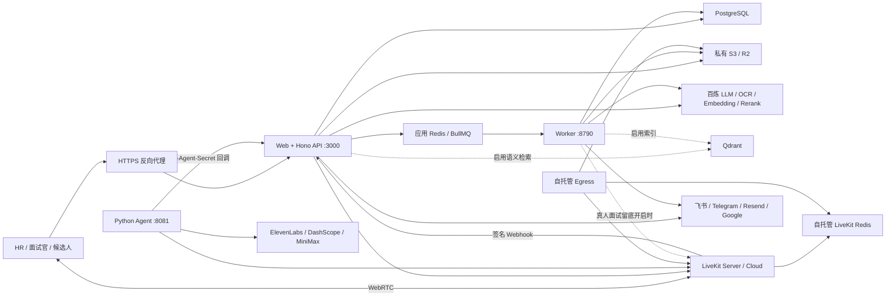

# AI Recruitment 配置与运维参考

- **项目名称**：AI Recruitment Copilot（AI 招聘助手）
- **文档版本**：`1.6`
- **代码核对日期**：2026-10-15（北京时间）
- **服务器核对日期**：2026-10-15（北京时间）；业务主机 `172.237.14.213`、音视频主机 `172.237.14.229`，详见 10.5。
- **代码基线**：`main`，Git SHA `2056e99ab88a79103541e330304595ed37f06044`
- **源码版本字段**：Web `2.0.2`；Backend / Worker `0.0.0`；Python Agent `1.0.0`。这些字段不代表本次正式发布号，交付以 Git SHA 和镜像 Digest 标识。
- **运行服务**：`web`、`worker`、`livekit-agent`；自托管音视频环境另含 LiveKit Server、LiveKit Redis、TLS 反向代理/TURN，以及按需部署的 Egress。当前环境的 TLS 代理为 Nginx。
- **研发负责人 / 运维负责人 / 实际发布日期**：正式交付单填写。
- **部署入口**：[部署操作指南](deployment/部署操作指南.md)，分别提供首次部署、现有环境更新、验收与回滚步骤。
- **HTML 阅读版**：[部署指南、参数参考与服务器核对](研发交付运维标准化文档.html)。

**执行部署从操作指南开始。本文用于查询参数、运行机制、故障处理及备份策略。**

> 本文以原《研发交付运维标准化文档》1.2 为基础，按上述提交的运行入口、配置读取点、容器文件及数据库迁移重新核对。沿用原文的自托管交付场景，同时说明 LiveKit Cloud 的差异。环境模板中存在历史残留，不能直接把模板中的所有变量都当作当前依赖。
>
> 本文已完成源码、部署声明及两台现有服务器的只读核对。正文中的默认值和部署示例仍是通用交付基线，现有环境的实际值及差异以 10.5 和配套核对报告为准。本次未修改远程配置、执行数据库迁移、构建发布镜像或进行真实面试/录制验收；未将健康检查通过等同于完整业务验收。本文不含真实凭据。

---

## 一、项目概述

### 1.1 服务简介

系统覆盖简历上传与解析、人才库、招聘管理、智能上传及岗位推荐、简历筛选与评价、AI 语音面试、真人面试、候选人报告、工作区协作和外部通知。

当前运行技术栈：

- Web：Node.js 22、TanStack Start、React 19、TanStack Router / Query、Vite / Nitro。
- API：Hono、Better Auth；默认挂载在 Web 同进程的 `/api` 下。
- 数据：PostgreSQL、Drizzle ORM；Mastra 使用同一数据库保存 AI 工作流和观测数据。
- 异步任务：Redis / BullMQ、独立 Node.js Worker。
- AI：阿里云百炼兼容接口、Mastra Agents / Workflows、Qwen OCR；语义检索使用 Embedding + Qdrant，岗位推荐使用 Rerank。
- 实时音视频：LiveKit Server / Cloud；AI 面试由 Python LiveKit Agent 执行。
- 语音链路：ElevenLabs Scribe v2 STT → DashScope LLM → MiniMax TTS。
- 文件：S3 兼容存储；AI 录像与真人面试留底使用私有 `RECORDING_R2_*` 存储。
- 集成：Google / 飞书登录、飞书机器人与文档、Google Sheets、Resend、Telegram、可选邮箱简历采集。

### 1.2 架构与服务边界

| 运行单元          | 当前职责                                                                                                        | 是否由仓库根 Compose 启动                 |
| ----------------- | --------------------------------------------------------------------------------------------------------------- | ----------------------------------------- |
| `web`             | 页面、SSR、Server Functions、Hono API、认证、回调；默认启动前执行数据库迁移                                     | 是                                        |
| `worker`          | 简历解析、评价生成、语义索引、岗位表格同步、可选邮箱采集；Telegram 延迟提醒、面试日志清理、可选真人面试媒体采样 | 是                                        |
| `livekit-agent`   | 注册到 LiveKit、执行 AI 语音面试、发送检查点和结果、按配置请求 Egress 录像                                      | 基础文件不含；生产覆盖文件以 `agent` 部署 |
| LiveKit Server    | 房间、信令、WebRTC 媒体转发、Agent 调度                                                                         | 否，自托管基础设施或 Cloud                |
| LiveKit Egress    | AI 面试 RoomComposite MP4 录像并上传录制存储                                                                    | 否，自托管录制时独立部署                  |
| 独立 Hono Backend | 与集成模式复用同一 `createServerApp()`；默认 `0.0.0.0:8787`                                                     | 否，当前交付默认不额外部署                |

`docker-compose.yml` **只定义 Web 和 Worker**，不包含 PostgreSQL、Redis、Qdrant、LiveKit、Agent 或对象存储。



应用 Redis 与 LiveKit Redis 的职责不同。LiveKit Server 和 Egress 必须使用相同的 LiveKit Redis 地址、账号、密码及逻辑库；应用队列建议另用实例。即使使用同一 Redis 服务，也必须隔离应用队列与音视频状态。

真人面试间歇留底由 Worker 的 `@livekit/rtc-node` 直接订阅音视频轨道完成，**不依赖 Egress**。Egress 仍用于 AI 面试的完整 MP4 录像，不能因为增加留底功能就删除。

### 1.3 依赖与部署条件

| 依赖                                     | 当前要求                                 | 说明                                                      |
| ---------------------------------------- | ---------------------------------------- | --------------------------------------------------------- |
| PostgreSQL                               | 必需；建议 15+，版本组合需验收           | 业务、认证、上传批次、提醒 Outbox、面试日志、Mastra 数据  |
| 应用 Redis                               | 完整功能必需；建议 7+                    | BullMQ 解析、评价、索引、同步和提醒队列                   |
| S3 兼容存储                              | 简历/附件必需                            | 当前 Worker 就绪检查要求明确提供 `S3_ENDPOINT`            |
| 百炼 API                                 | 默认 AI 与解析流程必需                   | 模型和区域须实际可用；OCR、Embedding、Rerank 分别核对权限 |
| LiveKit                                  | AI / 真人在线面试必需                    | 可自托管，也可使用 Cloud                                  |
| Python Agent                             | AI 语音面试必需                          | 真人面试不需要语音 Agent 参与                             |
| ElevenLabs / MiniMax                     | 当前 AI 语音链路必需                     | 分别用于 STT / TTS                                        |
| Egress                                   | 自托管且启用 AI 录像时必需               | Cloud 使用项目提供的 Egress 能力                          |
| 私有录制存储                             | AI 录像或真人留底启用时必需              | 两类数据保留策略不同，见第九章                            |
| Qdrant + Embedding                       | 语义检索/索引开启时必需                  | 代码仍在使用；关闭向量索引不等于停用全部智能岗位推荐      |
| Rerank API                               | 智能岗位推荐调用时需要                   | 默认 `qwen3-rerank`；无向量索引时仍可能调用               |
| Google / 飞书                            | 登录及集成按业务使用；凭据有现存强制校验 | 当前代码仍要求 Google 和两套飞书登录凭据，详见 5.3        |
| Telegram / Resend / Google Sheets / IMAP | 按功能配置                               | 未启用的集成不需要部署相应业务能力                        |

智能岗位推荐的候选岗位不超过 50 个时直接进入后续匹配；超过 50 个时尝试向量与关键词召回，向量不可用可回退关键词。后续 Rerank 和结构化模型仍需可用。不能把 `RESUME_SEMANTIC_INDEX_ENABLED=false` 解释为“智能上传不再需要 AI”。

### 1.4 相对旧版的主要调整

| 项目                                           | 本版处理                                                                            |
| ---------------------------------------------- | ----------------------------------------------------------------------------------- |
| 旧 Workflow 配置、Web 端旧 ElevenLabs 会话配置 | 从有效部署依赖和配置中移除；历史变量统一列在 5.2                                    |
| Vercel AI Gateway                              | 当前面试报告由 Mastra 模型配置驱动，不再要求 Gateway Key                            |
| `INTERVIEW_EVALUATION_MODEL`                   | 运行链路已不靠它选报告模型，但 Web 校验仍要求非空；暂时保留                         |
| Qdrant、Redis、Worker、LiveKit、ElevenLabs STT | 均有当前生产调用链，保留并说明启用条件                                              |
| Web 数据库迁移                                 | 补充镜像启动前自动迁移、锁与失败阻断行为                                            |
| 新增配置                                       | Mastra 模型/存储、Rerank、Telegram、面试诊断、媒体留底、候选人入场 Origin、历史导入 |
| 默认值                                         | 更新主模型、队列重试、评价/索引并发、OCR 页并发                                     |
| 构建与运行配置                                 | 补充 Compose 未透传的构建开关以及构建目录中 `.env` 的实际风险                       |
| 网络与备份                                     | 补充采样 Worker 的 RTC 出站、Qdrant、IMAP、Mastra schema 和长期留底策略             |

---

## 二、交付内容清单

### 2.1 软件包与镜像

| 交付物                                  | 构建文件 / 来源                                                     | 版本标识                                                |
| --------------------------------------- | ------------------------------------------------------------------- | ------------------------------------------------------- |
| Web 镜像                                | `apps/ai-recruitment-copilot/Dockerfile`；构建上下文为仓库根        | 建议 `2.0.2-2056e99a`；以实际镜像 Digest 为准           |
| Worker 镜像                             | `apps/ai-recruitment-copilot-worker/Dockerfile`；构建上下文为仓库根 | 建议 `2056e99a`；Digest 发布后填写                      |
| Agent 镜像                              | `apps/livekit-agent/Dockerfile`；构建上下文为 `apps/livekit-agent`  | 建议 `1.0.0-2056e99a`；Digest 发布后填写                |
| LiveKit Server / Egress / Caddy / Redis | 官方镜像或基础设施团队提供                                          | 固定验收版本和 Digest，不使用浮动 `latest` 作为发布凭据 |
| 源码归档、锁文件、本文档                | Git 基线及 `pnpm-lock.yaml`、`uv.lock`                              | 归档后记录 SHA256                                       |
| 发布清单                                | 环境、域名、组件开关、迁移结果、回滚版本、负责人                    | 由交付方补齐                                            |

以上镜像标签只是命名建议，本文不表示镜像已经构建或上传。

### 2.2 配置与脚本

| 文件                                                       | 用途与限制                                                          |
| ---------------------------------------------------------- | ------------------------------------------------------------------- |
| `docker-compose.yml`                                       | Web / Worker 编排、构建参数、健康检查；没有宿主机端口映射           |
| `apps/ai-recruitment-copilot/.env.example`                 | Web 变量参考；存在历史残留和遗漏，需结合第五章筛选                  |
| `apps/ai-recruitment-copilot-backend/.env.example`         | 独立 Backend 参考，也包含当前语义索引配置                           |
| `apps/ai-recruitment-copilot-worker/.env.example`          | Worker 参考；留底需要额外注入 LiveKit 和录制存储变量                |
| `apps/livekit-agent/.env.example`                          | Agent 参考；备用 STT 段不代表当前链路会自动切换                     |
| `apps/ai-recruitment-copilot/scripts/docker-entrypoint.sh` | 默认 Web 容器启动前运行 `.output/migrate.mjs`                       |
| `apps/ai-recruitment-copilot/scripts/migrate.ts`           | 打包进 Web 的迁移程序，使用 PostgreSQL advisory lock 串行化镜像迁移 |
| `apps/ai-recruitment-copilot/drizzle.config.ts`            | 源码 CLI 迁移配置，读取 Web 包下 `.env`，不覆盖已有进程环境变量     |
| `apps/ai-recruitment-copilot-backend/src/scripts/`         | 索引回填、初始化、数据修复脚本；不是容器启动的默认步骤              |
| `apps/livekit-agent/livekit.toml`                          | LiveKit Cloud Agent 部署配置，自托管不用它                          |
| 部署机 LiveKit 配置                                        | 由官方生成器/运维编排提供，业务仓库没有完整自托管基础设施栈         |

根目录 `.env` 是当前 Compose 约定的运行配置文件，并用于 Compose 变量插值；不会被普通 Shell 自动导出。当前覆盖文件将同一个根 `.env` 注入 Web、Worker、Agent，部署指南沿用这一方式。未来按服务拆分 Secret 时，应同步修改编排并保持 5.12 所列配置一致。首次部署使用[配套环境模板](deployment/templates/production.env.example)和[覆盖模板](deployment/templates/docker-compose.override.yml.example)；已有环境逐项合并。

### 2.3 数据库交付

- Schema 源码：`packages/db-schema/src/schema.ts`。
- 迁移目录：`apps/ai-recruitment-copilot/drizzle/`。
- Drizzle 记录表：`drizzle.__drizzle_migrations`。
- 当前最新活动迁移：`20261015150000_smart_resume_task_portfolios/migration.sql`。
- `_legacy_archive` 为历史归档，不手工执行。
- Mastra 默认使用同库 `mastra` schema，由 Mastra 存储初始化管理；不是另一套需要部署的 Workflow 服务。

本次升级特别需要覆盖下列迁移，但执行时应由迁移工具根据历史记录补齐**所有未执行迁移**，不能只挑表中几条：

| 迁移                                                                                                                               | 运维影响                                                 |
| ---------------------------------------------------------------------------------------------------------------------------------- | -------------------------------------------------------- |
| `20261008120000_add_interview_telemetry`                                                                                           | 新增面试遥测数据                                         |
| `20261009120000_add_human_interview_reminders`、`20261009160000_meeting_reminder_queue`                                            | 提醒投递、会议 Outbox、触发器和通知链路                  |
| `20261009200000_interview_media`                                                                                                   | 真人面试留底档案、媒体和访问记录                         |
| `20261009230000_fix_meeting_reminder_timezone`                                                                                     | 会议时间迁移到正确的带时区语义，修复提醒排期与相关触发器 |
| `20261009231000_interview_browser_evidence_columns`                                                                                | 浏览器环境证据字段                                       |
| `20261010120000_candidate_entry_credentials`、`20261012120000_candidate_entry_opt_in`、`20261013120000_entry_credential_responses` | 候选人入场凭据、按候选人开启、保存 WebAuthn 返回         |
| `20261015120000_smart_resume_upload`                                                                                               | 智能上传任务、岗位匹配画像                               |
| `20261015150000_smart_resume_task_portfolios`                                                                                      | 智能上传作品附件字段                                     |

提醒链路依赖 SQL 中的触发器与 `NOTIFY`，不能用 schema push 替代迁移。历史部署中可能残留 `workflow`、`graphile_worker` schema；停止使用其配置不等于可以直接删除历史数据，本交付不包含清库操作。

### 2.4 仓库与发布基线

仓库：[agniwen/ai-recruitment](https://github.com/agniwen/ai-recruitment)。

正式构建应使用干净的指定提交或受保护 Tag。本版不将本地未提交的开发启动脚本或工作区状态视为生产发布内容。每次更新代码基线，都应重新核对本文变量、迁移和镜像声明。

---

## 三、环境要求

### 3.1 操作系统与工具

| 组件              | 当前要求                                                                   |
| ----------------- | -------------------------------------------------------------------------- |
| Linux             | 建议 Ubuntu 22.04 / 24.04 LTS 或等价容器主机                               |
| CPU 架构          | 建议 x86_64；ARM64 需单独验证 Python 模型与 `@livekit/rtc-node` 等原生依赖 |
| Docker Engine     | 建议 24+                                                                   |
| Docker Compose    | **2.24.0+**；仓库使用 `env_file` 的 `path / required` 写法                 |
| Node.js           | Dockerfile 使用 `node:22-slim`                                             |
| pnpm              | 根 `packageManager` 固定 `11.5.2`                                          |
| Python / uv       | Agent 镜像默认 Python 3.13；按 `uv.lock` 安装，镜像内执行模型下载          |
| PostgreSQL 客户端 | 与服务端兼容，供备份、恢复及核对                                           |
| LiveKit CLI       | 自托管排障/验收按官方版本要求安装                                          |

Web、Backend、Worker、Agent 运行时均强制 `TZ=Asia/Shanghai`，部署环境提供其他值会被覆盖。共享 PostgreSQL 连接也明确使用 `TimeZone=Asia/Shanghai`。不得按旧文档假设可通过修改 `TZ` 任意切换业务时区；时间列仍应遵循各列类型和迁移定义。

Web / Worker 镜像安装 LibreOffice 和 Noto CJK 字体；Worker 还安装 CA 证书。不要用缺失这些依赖的精简镜像替代正式产物。

### 3.2 资源建议

下列为起步建议，不代表本项目已完成容量验收：

| 服务           | 起步建议                         | 容量关注点                                              |
| -------------- | -------------------------------- | ------------------------------------------------------- |
| Web/API        | 2–4 vCPU / 4–8 GB                | SSR、上传、模型流式响应、数据库连接；构建另留足内存     |
| Worker         | 4 vCPU / 8 GB 起步               | 普通解析默认并发 9，评价和索引各 50；应按配额与内存下调 |
| Python Agent   | 4 vCPU / 8 GB 起步               | 实际并发取决于 VAD、turn detector、模型延迟和会话长度   |
| LiveKit Server | 按并发房间、码率与网络压测       | CPU、网卡、UDP 可达性与 NAT                             |
| Egress         | 官方建议每实例至少 4 vCPU / 4 GB | RoomComposite 编码消耗高，按并发录像扩容                |
| PostgreSQL     | 2–4 vCPU / 4–8 GB 起步           | 业务表、Mastra 数据、日志、连接池和备份                 |
| Redis / Qdrant | 按任务量、向量数分别定容         | 队列持久化、积压、向量维度与索引内存                    |

启用真人媒体留底后，每个 Worker 当前最多同时采样 10 个房间，并通过数据库租约分配房间。这不是压测容量承诺；需要同时测量解析任务和 RTC 采样争用。

### 3.3 网络与端口

| 端口 / 协议       | 方向与范围                      | 用途                                                        |
| ----------------- | ------------------------------- | ----------------------------------------------------------- |
| 443 TCP           | 公网入站                        | Web HTTPS、LiveKit WSS、TURN/TLS 入口                       |
| 80 TCP            | LiveKit 证书签发入口            | 官方 Caddy 配置签发/续期证书                                |
| 7880 TCP          | LiveKit 私网，置于 TLS 代理之后 | API / WebSocket                                             |
| 7881 TCP          | LiveKit 公网入站                | ICE TCP 回退                                                |
| 3478 UDP          | 启用 TURN/UDP 时入站            | TURN / STUN                                                 |
| 50000–60000 UDP   | LiveKit 默认媒体入站            | ICE UDP；若使用 `rtc.udp_port=7882`，以单端口配置替代该范围 |
| 6789 TCP          | 私网监控                        | LiveKit Prometheus，仅配置启用时                            |
| 3000 TCP          | 私网或宿主机回环                | Web/API                                                     |
| 8790 TCP          | 私网或回环                      | Worker 健康及诊断                                           |
| 8081 TCP          | 私网或回环                      | Python Agent 健康                                           |
| 8787 TCP          | 仅独立 Backend                  | 非默认交付模式                                              |
| 5432 / 6379 TCP   | 应用到依赖的私网出站            | PostgreSQL / Redis；以实例实际端口为准                      |
| 6333 TCP 或 HTTPS | 启用向量功能时私网出站          | Qdrant REST；托管服务端口以服务地址为准                     |
| 993 TCP 等        | 启用邮箱采集时出站              | 邮箱账号配置的 IMAP/TLS 端口                                |
| 443 TCP           | 出站                            | AI、S3/R2、飞书、Google、Resend、Telegram API               |
| RTC TCP/UDP       | Agent、采样 Worker、Egress 出站 | 连接 LiveKit 媒体端点，不能只验证 HTTPS/WSS                 |

LiveKit 主域名与 TURN 域名必须解析到实际入口并使用受信证书。无四层负载均衡时，TURN/TLS 对外端口按官方要求使用 443。公网/企业网络应分别验证音视频和 TURN 回退。

反向代理需支持长响应和流式输出，对应用的 SSE/NDJSON/聊天流避免响应缓冲，并按上传大小和实际最长请求设置限制。LiveKit WebSocket 的 Upgrade 代理与 UDP 媒体放通分别配置。开启 `INTERVIEW_TELEMETRY_IP_HEADER=x-real-ip` 时，代理必须覆盖该头，且应用不得被不可信客户端绕过代理直连。

---

## 四、部署机制与补充参考

### 4.1 预检清单

可执行流程已集中到[部署操作指南](deployment/部署操作指南.md)。本章解释部署机制与可选模式，实际操作按指南中的首次部署或更新路径执行。

- [ ] 记录交付 SHA、不可变镜像 Digest、上一个可回滚版本。
- [ ] 确定本环境启用的录像、向量检索、Telegram、媒体留底、邮箱采集等功能。
- [ ] PostgreSQL、应用 Redis、S3、AI Provider 已准备；按功能准备 LiveKit / Egress / R2 / Qdrant。
- [ ] 确认外部域名、OAuth 回调、LiveKit 和 Telegram Webhook 可达。
- [ ] 按第五章生成配置，删除历史残留项；校验仍强制必填的变量不漏。
- [ ] Web 构建参数与运行时 URL、Agent 名及功能开关一致。
- [ ] 已备份完整 PostgreSQL 数据库并验证恢复；备份应包含 `public`、`drizzle`、`mastra` 及其他实际使用的 schema。
- [ ] 在预发布环境演练旧库升级，特别验证提醒触发器、会议时区与入场凭据。
- [ ] Web 容器启动用户的数据库权限能完成自动迁移；Mastra 初始化权限满足要求。
- [ ] 本次待交付的真实外部能力已按 4.7 验收并记录结果。

### 4.2 检出与准备配置

执行顺序见[部署操作指南](deployment/部署操作指南.md)。当前自托管应用的文件组合固定为：

| 文件                          | 作用                                                        |
| ----------------------------- | ----------------------------------------------------------- |
| `docker-compose.yml`          | 仓库基础声明，定义 Web / Worker                             |
| `docker-compose.override.yml` | 定义 Agent、外部基础设施网络、回环端口、时区挂载及 `nofile` |
| 根 `.env`                     | Compose 插值与 Web / Worker / Agent 的运行环境              |

现有服务器的覆盖文件没有纳入 Git。新环境使用配套覆盖模板前，必须取得完整基础设施包并确认外部网络；已有环境保留原覆盖文件、按发布单合并。所有应用命令显式加载基础文件和覆盖文件，不能只指定基础文件。

**构建目录限制：**根 `.dockerignore` 没有排除所有 `.env`；Web Dockerfile 会复制整个 Web / Backend 目录。生产凭据不放入这些源码子目录；构建使用干净源码与公开参数，运行凭据由根 `.env` 或受控 Secret 注入。Agent 自己的 `.dockerignore` 已排除 `.env` 和 `.env.*`。

新模板补充公开构建参数、日志与停止宽限期。具体与现场覆盖文件的差异见操作指南的模板说明；核对报告第 9 节保留现场文件结构。

### 4.3 构建与发布镜像

部署指南采用指定 SHA 的源码构建路径，构建 Web、Worker、Agent 后运行迁移，再启动应用。执行时按对应的首次部署或更新流程操作。

使用预构建镜像时，交付方需另外提供三类镜像地址、Digest 及包含 `image: 仓库地址@sha256:摘要` 的生产声明。仓库基础 Compose 只有 `build`，不能假定 `docker compose pull` 会自动找到发布镜像。

Web 构建期的服务端占位值仅用于通过构建校验，不作为生产运行值。公开变量及 Compose 的透传范围见 5.4；修改公开功能开关后需要重建 Web，并保持运行值一致。

### 4.4 备份、迁移与启动

当前 Web 默认容器启动顺序：

```text
docker-entrypoint.sh
  → node .output/migrate.mjs
  → node .output/server/index.mjs
```

迁移失败时入口脚本退出，Web 不会继续启动。迁移程序用 PostgreSQL advisory lock 串行化应用镜像的并发启动迁移，不代表任意外部 CLI 也共用这把锁。

更新操作按部署指南执行：保留旧版本 → 构建目标镜像 → 维护窗口与在途任务收尾 → 停止旧应用 → 数据库备份 → 使用待发布 Web 镜像迁移 → 启动新应用 → 验收。新 Worker 不得早于数据库迁移成功启动。Web 正常入口会再次检查迁移记录，不重复已应用的迁移。

源码维护场景使用 `pnpm --filter @arc/ai-recruitment-copilot env:validate` 和 `pnpm db:migrate` 时，需由受控环境提供正确变量。CLI 迁移通过 `drizzle.config.ts` 读取 Web 包 `.env`，已注入的进程变量优先；根 Compose `.env` 不会自动进入 CLI 环境。此方式不作为指南中的容器发布入口。

`pnpm start` 直接启动 Node 时没有 Docker 入口的自动迁移步骤。不要跳过失败 SQL 或删除迁移记录；数据库权限同时需满足业务迁移和 Mastra / Chat 状态存储初始化。

### 4.5 自托管 LiveKit Server 与 Egress

部署指南采用运维完整配置包。当前实际音视频主机为 `172.237.14.229`，目录 `/opt/livekit`，Compose 文件为 `docker-compose.yml`。业务主机上的旧音视频目录不参与本次运行。

需要新建完整基础设施包时，由运维按 [LiveKit VM 部署指南](https://docs.livekit.io/transport/self-hosting/vm/) 生成并审核完整 Server、Redis、TURN/TLS 与 Egress 配置，登记版本和 Digest。以下仅展示业务对接字段，不替代完整配置：

```yaml
port: 7880
rtc:
  tcp_port: 7881
  port_range_start: 50000
  port_range_end: 60000
  use_external_ip: true
redis:
  address: "<livekit-redis-host>:6379"
keys:
  "<LIVEKIT_API_KEY>": "<LIVEKIT_API_SECRET>"
webhook:
  api_key: "<LIVEKIT_API_KEY>"
  urls:
    - "https://<应用域名>/api/livekit/webhook"
```

当前环境的专用 Redis 地址为 `127.0.0.1:6380`，与示例占位地址不同。Egress 使用同一 LiveKit 项目的 `ws_url`、API Key/Secret 和 Redis，并能访问录制存储。Chrome sandbox、`SYS_ADMIN` / seccomp、共享内存和停止策略按验收版本与容量配置。监控端口仅在实际启用后纳入探针。

Agent 每次请求 Egress 时传入 `RECORDING_R2_*` 对应的上传配置；Web 使用同一存储定位录像。Webhook 还负责真人面试入离会、遥测和采样唤醒，即使关闭 AI 录像也需要保留。

使用 LiveKit Cloud 时，Server、TURN、Redis 与 Egress 由相应 Cloud 项目承担，需要另行确定交付方式；应用凭据和回调仍需验收。

### 4.6 部署 Python Agent

默认交付由应用 `docker-compose.override.yml` 定义 `agent`，与 Web、Worker 共用根 `.env`。构建、启动和回滚均纳入操作指南的三服务流程，不重复创建独立容器。

Agent 必须配置 `LIVEKIT_*`、`AGENT_NAME`、`DASHSCOPE_API_KEY`、`ELEVEN_API_KEY`、`MINIMAX_API_KEY`、`CALLBACK_BASE_URL` 和 `AGENT_CALLBACK_SECRET`；录像开启时补齐 `RECORDING_R2_*`。

自托管设置 `INTERVIEW_SELF_HOSTED=1`，使用 `v1-mini` turn detector、VAD interruption，并关闭 Cloud 专属噪声消除。Cloud 场景不照抄此开关。

Agent 通过出站 WebSocket 注册，无需公网入站端口；健康端口通过覆盖文件绑定到宿主机回环 `8081`。保留 `src/agent.py` 入口，Docker 构建已按锁文件安装依赖并下载所需模型。

停止 Agent 前先等待在途面试结束。配套模板的 `15m` 仅为宽限期示例，需覆盖最长允许面试与收尾时间。

### 4.7 健康检查与业务验收

在部署目录执行：

```bash
docker compose -f docker-compose.yml -f docker-compose.override.yml exec -T web node -e \
  "fetch('http://127.0.0.1:3000/api/ready').then(async r => { console.log(r.status, await r.text()); process.exit(r.ok ? 0 : 1) }).catch(() => process.exit(1))"

docker compose -f docker-compose.yml -f docker-compose.override.yml exec -T worker node -e \
  "fetch('http://127.0.0.1:8790/readyz').then(async r => { console.log(r.status, await r.text()); process.exit(r.ok ? 0 : 1) }).catch(() => process.exit(1))"

curl --fail --silent --show-error http://127.0.0.1:8081/
```

Agent 的 curl 依赖应用覆盖文件中的回环端口映射。独立 Backend 没有实现 Web 的 `/api/health` 或 `/api/ready`，不能直接复用这两个路径作为独立模式探针。

| 验收流程      | 完成标准                                                                          |
| ------------- | --------------------------------------------------------------------------------- |
| 登录与工作区  | 实际使用的 Google / 飞书登录正常；工作区权限、岗位和招聘记录正常                  |
| 简历解析      | 上传真实代表格式，确认对象存储、入队、Worker 解析、结构化结果、评价闭环           |
| 智能上传      | 推荐岗位范围正确，匹配画像和 Rerank 正常；启用向量时验证索引构建及召回            |
| AI 面试       | Agent 调度、中文识别、回答播报、检查点、结果回传、报告生成均成功                  |
| AI 录像       | 启用时确认 MP4 写入、`egress_ended` 回写最终状态、后台授权播放                    |
| 真人面试      | 候选人/面试官入会、音视频、屏幕共享、入离会及结束状态正确                         |
| Telegram 提醒 | 启用时用受控测试对象验证绑定、预约前提醒、改期、取消、北京时间及发送记录          |
| 媒体留底      | 启用时验证各参与者样本、私有读取、管理员访问和清理审计                            |
| 入场凭据      | 启用候选人开关时，在目标浏览器验证 HTTPS Origin、注册、验证、取消及管理员关闭流程 |
| 其他集成      | 按发布范围验证 Resend、飞书文档/通知、Google Sheets、邮箱采集                     |
| 网络与恢复    | 企业网络 TURN 回退；Worker 重启后待处理任务恢复；Agent 发布期间在途面试处理       |

健康接口不测试模型余额、真实 OCR、STT/TTS、录像可播放或通知送达。未启用的业务项在交付单中标注“不启用”，不以健康检查代替验收。

---

## 五、配置参数说明

### 5.1 配置规则与来源

本章是当前交付的配置入口：

- **必填**：运行或现存校验要求；缺少会阻止启动、请求或对应流程。
- **条件必填**：仅在指定功能启用时配置。
- **可调**：代码有明确默认值；模板值与代码默认不同处会说明。
- **历史残留**：当前运行链路不使用，不再分发到新的部署 Secret。
- **校验保留**：业务已不读取，但当前校验仍要求，不能直接删。

配置读取优先级：

| 服务 / 工具      | 读取方式                                                                                                      |
| ---------------- | ------------------------------------------------------------------------------------------------------------- |
| Compose          | 根 `.env` 用于插值；服务通过 `env_file` 注入容器                                                              |
| Web 构建         | Vite 构建环境；已有进程环境优先于文件值；公开变量进入前端产物                                                 |
| Web 容器         | 容器环境；不会自动重新读取宿主机修改后的 `.env`                                                               |
| 独立 Backend     | 已有进程变量优先，然后依次 Web `.env.local`、Web `.env`、Backend `.env.local`、Backend `.env`；先读到的值优先 |
| 源码 Worker      | 已有进程变量优先，然后依次 Web `.env.local`、Web `.env`、Worker `.env.local`、Worker `.env`                   |
| Python Agent     | 进程环境和 `load_dotenv()`；生产以显式注入为准                                                                |
| 源码 Drizzle CLI | 已有进程变量优先，然后读取 Web 包 `.env`                                                                      |

模板里写了某个默认值，不代表代码一定有该默认。以下表格区分“建议/模板值”和“代码默认”。

### 5.2 可从当前部署中移除的历史配置

以下仅从本版本的**有效配置清单**移除，不涉及删除第三方资源或历史数据库：

| 历史变量 / 组件                                                                                                         | 当前代码结论                                                    | 交付处理                                                 |
| ----------------------------------------------------------------------------------------------------------------------- | --------------------------------------------------------------- | -------------------------------------------------------- |
| `WORKFLOW_TARGET_WORLD`；旧 Workflow / Graphile 运行服务                                                                | 当前不使用原 Workflow 配置；业务工作流在 Mastra + BullMQ 中执行 | 删除运行变量，不额外部署旧服务；历史 schema 另行评估     |
| `AI_GATEWAY_API_KEY`                                                                                                    | 当前面试报告不调用 AI SDK Gateway                               | 不再分发；报告模型按 5.5 配置                            |
| `ELEVENLABS_API_KEY`、`ELEVENLABS_AGENT_ID`、`ELEVENLABS_WEBHOOK_SECRET`                                                | Web 端旧会话配置未接入当前链路                                  | 删除 Web 配置；保留 Python Agent 的 `ELEVEN_API_KEY`     |
| `GOOGLE_GENERATIVE_AI_API_KEY`、`ZHIPU_API_KEY`、`ZHIPU_MODEL`、`ALIBABA_VISION_MODEL`                                  | 当前业务没有读取这些独立 Provider 配置                          | 不再配置独立密钥；聊天目录中的供应商品牌不代表直连其 API |
| `NEXT_PUBLIC_PUBLIC_URL`、`NEXT_PUBLIC_APP_URL`、`ADMIN_ORGANIZATION_ID`                                                | 当前运行代码不使用                                              | 删除；公开地址和平台角色按现行机制管理                   |
| `DEEPGRAM_API_KEY`                                                                                                      | Agent 模板仍有，但当前会话固定使用 ElevenLabs                   | 从当前链路配置中移除，不宣称自动备用                     |
| `DASHSCOPE_STT_MODEL`、`DASHSCOPE_STT_MAX_SENTENCE_SILENCE_MS`、`DASHSCOPE_STT_VOCABULARY_ID`、`DASHSCOPE_WORKSPACE_ID` | 备用 STT 代码/模板不被当前 `AgentSession` 使用                  | 不作为本版生产配置；恢复备用方案需另行实现并验收         |

`INTERVIEW_EVALUATION_MODEL` **不在可直接删除名单中**：虽然当前报告 Agent 使用 `mastraModels.structuredModel`，Web 的 `server.ts` 环境校验仍要求该变量非空。建议与结构化模型名统一填写以通过现有校验；不要继续按旧文档给它配 Gateway Key，也不要指望修改它就能切换报告模型。

### 5.3 Web / Backend 核心配置

表中“API”同时指集成在 Web 的 Hono 和可选的独立 Backend。

| 变量                                | 适用服务                   | 要求 / 值                                            | 用途                                                                   |
| ----------------------------------- | -------------------------- | ---------------------------------------------------- | ---------------------------------------------------------------------- |
| `DATABASE_URL`                      | API、Worker、迁移          | 必填                                                 | 同一环境使用同一业务库；包括 Mastra 同库存储                           |
| `REDIS_URL`                         | API、Worker                | 完整功能必填                                         | `redis://` / `rediss://`；Web 不配置时可能仍就绪，不能据此认为队列可用 |
| `BETTER_AUTH_SECRET`                | API；启用提醒的 Worker     | 必填随机密钥                                         | 认证及会议邀请签名；各副本一致                                         |
| `BETTER_AUTH_URL`                   | Web 构建、API              | 必填 HTTPS Origin                                    | 对外认证地址                                                           |
| `NEXT_PUBLIC_BASE_URL`              | Web 构建、API、提醒 Worker | 必填前端 Origin                                      | 公开业务链接；独立 Backend 也应填候选人访问的前端地址                  |
| `NEXT_PUBLIC_BETTER_AUTH_URL`       | Web 构建                   | 必填 Origin                                          | 浏览器认证 API 地址；默认同源交付与前两项一致                          |
| `INTERVIEW_ENTRY_CREDENTIAL_ORIGIN` | API                        | 可选，默认 `NEXT_PUBLIC_BASE_URL`                    | 候选人实际访问的唯一页面 Origin，包含非默认端口；不是后端内网地址      |
| `POSTGRES_POOL_MAX`                 | 共享 Backend 数据库连接    | 生产默认 `10`，非生产 `5`                            | 单个共享连接池上限；Mastra/Chat/监听等额外连接需另计                   |
| `POSTGRES_CONNECT_TIMEOUT_SECONDS`  | API、Worker、镜像迁移      | 默认 `10`                                            | 建连超时，秒                                                           |
| `POSTGRES_IDLE_TIMEOUT_SECONDS`     | 同上                       | 默认 `60`                                            | 空闲连接回收，秒                                                       |
| `POSTGRES_MAX_LIFETIME_SECONDS`     | 同上                       | 默认 `1200`                                          | 连接最大寿命，秒                                                       |
| `TZ`                                | 全部应用进程               | 固定 `Asia/Shanghai`                                 | 代码会覆盖外部值                                                       |
| `HOST` / `PORT`                     | Web / 独立 Backend         | Web 镜像 `0.0.0.0:3000`；Backend 默认 `0.0.0.0:8787` | 修改后同步代理/探针                                                    |
| `WORKER_HOST` / `WORKER_PORT`       | Worker                     | 默认 `0.0.0.0:8790`                                  | 修改后同步探针                                                         |
| `WORKER_DIAGNOSTICS_SECRET`         | Worker                     | 使用队列诊断时必填                                   | `/queues/*` 的 Bearer Token                                            |

当前 Web 环境校验**无条件要求**下列配置非空，即使对应入口暂未启用：

- `GOOGLE_CLIENT_ID`、`GOOGLE_CLIENT_SECRET`。
- `FEISHU_APP_ID`、`FEISHU_APP_SECRET`、`FEISHU_APP_ID2`、`FEISHU_APP_SECRET2`。
- `ALIBABA_BASE_URL`、`ALIBABA_MODEL`、`ALIBABA_FAST_MODEL`、`ALIBABA_STRUCTURED_MODEL`。
- `INTERVIEW_EVALUATION_MODEL`、`MINIMAX_TTS_BASE_URL`、`QWEN_OCR_BASE_URL`、`QWEN_OCR_MODEL`。
- `S3_REGION`、`S3_KEY_PREFIX`、`S3_FORCE_PATH_STYLE`。
- `RECORDING_R2_REGION`、`RECORDING_R2_KEY_PREFIX`、`RECORDING_R2_FORCE_PATH_STYLE`。
- 前述认证密钥及公开 URL。

Google / 两套飞书凭据也被 Backend 认证初始化读取。隐藏登录按钮不等于解除凭据要求，不得在生产使用 Dockerfile 中的 `build-time-placeholder`。各类文件桶、AI Key、LiveKit Key 等虽然不一定在同一集中校验器中检查，业务链路仍然需要。

### 5.4 Web 构建变量与开关

| 变量                                                        | 当前默认 / 要求                     | 作用                                    |
| ----------------------------------------------------------- | ----------------------------------- | --------------------------------------- |
| `NEXT_PUBLIC_AGENT_NAME`                                    | 必填；模板及 Docker 默认 `giaogiao` | 与实际注册 Agent 名一致                 |
| `NEXT_PUBLIC_ENABLE_GOOGLE_LOGIN`                           | 必填布尔；模板及 Docker `false`     | `true` 显示 Google 入口并隐藏飞书入口   |
| `NEXT_PUBLIC_ENABLE_CANDIDATE_SPECIFIC_INTERVIEW_QUESTIONS` | 默认 `true`                         | 候选人个性化 AI 面试问题；前后端一致    |
| `NEXT_PUBLIC_ENABLE_INTERVIEW_RECORDING`                    | 默认 `true`                         | AI 面试录像；前后端一致，不控制真人留底 |
| `NEXT_PUBLIC_ENABLE_WATERMARK`                              | 默认 `true`                         | 用户水印                                |
| `NEXT_PUBLIC_ENABLE_INTERVIEW_DEVELOPER_DETAILS`            | 默认 `false`                        | 开发诊断信息显示                        |
| `NEXT_PUBLIC_FORCE_APP_UPDATE_NOTICE`                       | 默认 `false`                        | 开发用强制更新提示，生产保持关闭        |

`NEXT_PUBLIC_*` 会进入前端产物，不能包含密钥；修改后需重建 Web 镜像。当前根 Compose 只透传以下五个构建参数：

`BETTER_AUTH_URL`、`NEXT_PUBLIC_AGENT_NAME`、`NEXT_PUBLIC_BASE_URL`、`NEXT_PUBLIC_BETTER_AUTH_URL`、`NEXT_PUBLIC_ENABLE_GOOGLE_LOGIN`。

录像与个性化题目开关虽然在 Dockerfile 有 `ARG`，根 Compose 尚未透传。需要改变默认值时，在交付覆盖声明的 `web.build.args` 中明确传入，并保持运行环境同值；只改根 `.env` 会造成前端仍使用构建默认值。

水印、开发详情和强制更新提示在当前 Dockerfile 没有对应 `ARG`。若要改变默认值，构建流水线必须提供仅含公开值的 Web 构建环境文件，或完成专门的 Dockerfile 透传变更；不能假设任意 `--build-arg` 已生效。本次文档更新不改变这些实现。

### 5.5 LLM、OCR、Mastra、Embedding 与 Rerank

| 变量                                                                | 要求 / 默认                                                        | 说明                                                                                                             |
| ------------------------------------------------------------------- | ------------------------------------------------------------------ | ---------------------------------------------------------------------------------------------------------------- |
| `ALIBABA_API_KEY`                                                   | API / Worker 默认 AI 流程必填                                      | 百炼兼容接口 Key；Worker 就绪显式检查                                                                            |
| `ALIBABA_BASE_URL`                                                  | Web 必填；模板 `https://dashscope.aliyuncs.com/compatible-mode/v1` | 通用业务模型接口；与账号区域/模型一致                                                                            |
| `ALIBABA_MODEL` / `ALIBABA_FAST_MODEL` / `ALIBABA_STRUCTURED_MODEL` | Web 必填；当前 Web/Worker 模板均 `deepseek-v4-flash-0731`          | 主、快速、结构化任务；模型在目标账号可用性另验                                                                   |
| `MASTRA_CHAT_MODEL` / `MASTRA_LONG_CONTEXT_MODEL`                   | 可选                                                               | 分别覆盖主/长上下文模型；未设时主要沿用 `ALIBABA_MODEL`                                                          |
| `MASTRA_FAST_MODEL` / `MASTRA_STRUCTURED_MODEL`                     | 可选                                                               | 分别覆盖快速/结构化模型；后者影响简历抽取、面试评价等                                                            |
| `MASTRA_SCORER_MODEL`                                               | 可选，回退快速模型                                                 | 评分器模型                                                                                                       |
| `ALIBABA_CODING_PLAN_API_KEY`                                       | 仅相关 Provider 模式使用                                           | Mastra 有 Coding Plan 兼容分支；默认显式 Base URL 的交付优先使用 `ALIBABA_API_KEY`，不能据此省略 Worker 所需 Key |
| `MASTRA_POSTGRES_SCHEMA`                                            | 默认 `mastra`                                                      | Mastra 数据所在 schema；副本一致，修改视为数据空间切换                                                           |
| `INTERVIEW_EVALUATION_MODEL`                                        | Web 校验必填                                                       | 当前业务不靠此变量选模型；见 5.2                                                                                 |
| `QWEN_OCR_BASE_URL`                                                 | Web 校验必填；模板为百炼兼容地址                                   | OCR 需可用的按量接口，不照抄 Coding Plan 地址                                                                    |
| `QWEN_OCR_MODEL`                                                    | Web 校验必填；模板 `qwen-vl-ocr-latest`                            | PDF / 图片 OCR                                                                                                   |
| `QWEN_OCR_API_KEY`                                                  | 可选，回退 `ALIBABA_API_KEY`                                       | 可单独配置 OCR 按量 Key，特别是主 LLM 使用套餐 Key 时                                                            |
| `RESUME_PARSE_PROVIDER`                                             | 默认 `ocr-llm`                                                     | 仅支持 `ocr-llm` / `aliyun-docmining`；后者调用代码固定的百炼文档智能接口，需实测账号权限                        |

当前面试报告的结构化评价使用 Mastra 的 `structuredModel`，文字摘要使用 `fastModel`；不要沿用旧文档“`INTERVIEW_EVALUATION_MODEL=google/gemini-2.5-flash` + Gateway”的选模解释。招聘 Copilot 的模型选择还受代码内模型目录/具体 Agent 配置影响，不能把一个环境变量视为所有聊天入口的全局开关。

语义索引与重排：

| 变量                            | 适用服务                             | 要求 / 默认                                                                              |
| ------------------------------- | ------------------------------------ | ---------------------------------------------------------------------------------------- |
| `RESUME_SEMANTIC_INDEX_ENABLED` | API、Worker                          | 默认关闭；开启后应同时启用索引消费者                                                     |
| `RESUME_EMBEDDING_MODEL`        | API、Worker                          | 默认 `text-embedding-v4`                                                                 |
| `RESUME_EMBEDDING_DIMENSIONS`   | API、Worker                          | 默认 `1024`；需与 Qdrant Collection 一致                                                 |
| `RESUME_EMBEDDING_VERSION`      | API、Worker                          | 默认 `dashscope-text-embedding-v4-1024-v1`                                               |
| `RESUME_EMBEDDING_BASE_URL`     | API、Worker                          | 默认百炼兼容地址；旧别名 `ALIBABA_EMBEDDING_BASE_URL` 仍可读取，推荐使用前者             |
| `RESUME_EMBEDDING_API_KEY`      | API、Worker                          | 留空回退 `ALIBABA_API_KEY`                                                               |
| `QDRANT_URL` / `QDRANT_API_KEY` | API、Worker                          | 索引开启时提供 URL；按服务鉴权方式提供 Key                                               |
| `QDRANT_RESUME_COLLECTION`      | API、Worker                          | 默认 `resume_semantic_v1`；用于当前简历/岗位语义数据空间                                 |
| `RESUME_RERANK_MODEL`           | 执行智能推荐的 API / Worker 相关任务 | 默认 `qwen3-rerank`                                                                      |
| `RESUME_RERANK_API_KEY`         | 同上                                 | 回退 Embedding 配置的 Key，最终可回退 `ALIBABA_API_KEY`                                  |
| `RESUME_RERANK_URL`             | 同上                                 | 默认取 Embedding Base URL 的 Origin 加 `/api/v1/services/rerank/text-rerank/text-rerank` |

`RESUME_RERANK_URL` 是完整调用地址，不是 OpenAI 兼容接口根路径。自定义网关、不同区域或套餐账号需分别核对 Embedding / Rerank 路由和授权，不能仅保证主 LLM 可用。调整 Embedding 模型/维度/版本/Collection 后需安排索引回填与验证，不只重启服务。

### 5.6 文件存储与录制存储

| 变量组                                                         | 使用方                        | 配置要求                                                                                   |
| -------------------------------------------------------------- | ----------------------------- | ------------------------------------------------------------------------------------------ |
| `S3_ENDPOINT`、`S3_BUCKET_NAME`                                | API、Worker                   | 简历/附件存储；当前 Worker 就绪要求 Endpoint 非空，即使使用 AWS S3 也填写适用区域 Endpoint |
| `S3_ACCESS_KEY_ID`、`S3_SECRET_ACCESS_KEY`                     | API、Worker                   | 提供相应读写权限                                                                           |
| `S3_REGION`                                                    | API、Worker                   | Web 校验必填；按供应商填写                                                                 |
| `S3_KEY_PREFIX`                                                | API、Worker                   | Web 校验必填；模板 `uploads`                                                               |
| `S3_FORCE_PATH_STYLE`                                          | API、Worker                   | Web 校验必填；Web 模板 `false`，Docker 构建占位 `true`，运行值按实际供应商填写             |
| `RECORDING_R2_ENDPOINT`、`RECORDING_R2_BUCKET_NAME`            | API、Agent；留底 Worker       | 录像或留底开启时必填；桶为私有                                                             |
| `RECORDING_R2_ACCESS_KEY_ID`、`RECORDING_R2_SECRET_ACCESS_KEY` | 同上                          | 上传、读取，以及管理员清理所需删除权限                                                     |
| `RECORDING_R2_REGION`                                          | 同上                          | API 校验必填；模板 / Agent 默认 `auto`                                                     |
| `RECORDING_R2_FORCE_PATH_STYLE`                                | 同上                          | API 校验必填；模板 / Agent 默认 `true`                                                     |
| `RECORDING_R2_KEY_PREFIX`                                      | API、留底 Worker 共享存储配置 | API 校验必填；模板 `recordings`；Agent 使用服务端分配的具体文件 Key，不自行读取此前缀      |

S3 与 R2 是两组用途不同的配置，不应只改其中一端的桶或前缀。`RECORDING_R2_*` 通过 S3 兼容接口访问存储，变量名称不限定供应商；当前环境两组配置均连接 MinIO，实际桶和前缀见 10.5。Agent 缺少必要录制凭据会跳过录像，Egress 启动失败也不一定阻止语音面试继续，因此必须独立验收录像。

真人留底对象使用 `human-interview-samples/` Key。该前缀长期保留，不能套用整个录像桶的统一自动到期规则，见 9.1。

### 5.7 Worker、队列与历史导入

| 变量                                                            | 当前代码默认 / 要求                | 说明                                                                      |
| --------------------------------------------------------------- | ---------------------------------- | ------------------------------------------------------------------------- |
| `RESUME_PARSE_QUEUE_PREFIX`                                     | 未设时按数据库连接身份生成哈希前缀 | API / Worker 一致；同环境数据库用户名、主机或库名变化可能改变默认队列前缀 |
| `RESUME_PARSE_QUEUE_ATTEMPTS`                                   | 普通解析 `2`；历史导入 `3`         | 显式设置覆盖这两类队列的尝试次数；不是所有队列通用参数                    |
| `RESUME_PARSE_QUEUE_BACKOFF_MS`                                 | `30000`                            | 解析任务指数退避基值，毫秒                                                |
| `RESUME_PARSE_WORKER_CONCURRENCY`                               | `9`                                | 普通解析每实例并发                                                        |
| `RESUME_REVIEW_GENERATION_WORKER_CONCURRENCY`                   | `50`                               | 评价生成每实例并发                                                        |
| `RESUME_SEMANTIC_INDEX_WORKER_CONCURRENCY`                      | `50`                               | 索引每实例并发，索引开启时使用                                            |
| `JOB_DESCRIPTION_GOOGLE_SHEET_SYNC_WORKER_CONCURRENCY`          | `1`                                | 表格同步并发                                                              |
| `RESUME_PARSE_STALE_PROCESSING_SECONDS`                         | `900`                              | 重启恢复时判定中断处理的阈值                                              |
| `RESUME_PARSE_OCR_PAGE_CONCURRENCY`                             | `4`                                | 每份 PDF 的 OCR 页并发；需连同任务并发计算 API 峰值                       |
| `RESUME_PARSE_OCR_ATTEMPTS` / `RESUME_PARSE_OCR_RETRY_DELAY_MS` | `3` / `1000`                       | OCR 请求重试                                                              |
| `RESUME_PARSE_DISABLE_CACHE`                                    | 默认关闭                           | 仅专项基准/排查时绕过同 Hash 解析缓存                                     |
| `RESUME_PARSE_LOG_STEPS`                                        | 生产默认关闭                       | 解析子步骤日志；开发模式会开启；避免长期记录简历内容片段                  |
| `LIBREOFFICE_BIN`                                               | 镜像设置 `/usr/bin/soffice`        | 非标准环境才需调整                                                        |

历史导入默认关闭，启用可能自动发现并提交历史文件，应在明确安排导入后设置：

| 变量                                                                     | 默认 / 条件                               |
| ------------------------------------------------------------------------ | ----------------------------------------- |
| `ENABLE_LEGACY_PARSE`                                                    | `false`，API 与 Worker 按同一功能范围配置 |
| `LEGACY_PARSE_WORKSPACE_SLUG`                                            | 启用时必填，目标工作区                    |
| `LEGACY_PARSE_UPLOADER_EMAIL`                                            | 启用时必填，须是目标工作区成员            |
| `LEGACY_PARSE_QUEUE_LOW_WATERMARK` / `LEGACY_PARSE_QUEUE_HIGH_WATERMARK` | `200` / `500`，低水位必须小于高水位       |
| `HISTORICAL_RESUME_OBJECT_LOCK_TTL_MS`                                   | `600000`，可续租对象锁 TTL                |

历史解析集群并发当前固定为 `12`，不由普通解析并发变量修改。Worker 启动时恢复普通待处理任务；启用历史导入后定期发现/补队列，启用语义索引后恢复待索引来源。恢复成功仍需观察失败项，不能把清空 Redis 当作常规修复。

### 5.8 LiveKit 与 Python Agent

| 变量                                                   | 使用方                  | 当前要求 / 默认                                                                  |
| ------------------------------------------------------ | ----------------------- | -------------------------------------------------------------------------------- |
| `LIVEKIT_URL`、`LIVEKIT_API_KEY`、`LIVEKIT_API_SECRET` | API、Agent；留底 Worker | 同一项目/Server；生产使用可达的 WSS 地址                                         |
| `LIVEKIT_PROMETHEUS_URL`                               | API                     | 可选，服务器访问的私网 `/metrics` 地址，用于平台 LiveKit 指标                    |
| `AGENT_NAME`                                           | API、Agent              | 默认 `giaogiao`；与 Web 构建 `NEXT_PUBLIC_AGENT_NAME` 一致                       |
| `INTERVIEW_SELF_HOSTED`                                | Agent                   | 自托管设 `1`；Cloud 不设置或关闭                                                 |
| `INTERVIEW_DISABLE_NOISE_CANCELLATION`                 | Agent                   | 可选手工排查开关；自托管已自动关闭 Cloud 噪声消除                                |
| `DASHSCOPE_API_KEY`                                    | Agent                   | 对话 LLM 必填                                                                    |
| `DASHSCOPE_LLM_MODEL`                                  | Agent                   | 代码默认 `deepseek-v4-flash-0731`；建议显式写入，不传空字符串                    |
| `ELEVEN_API_KEY`                                       | Agent                   | ElevenLabs STT 插件隐式读取；正确变量名                                          |
| `MINIMAX_API_KEY`                                      | Agent；API 音色预览     | 当前 TTS / 音色预览必需                                                          |
| `MINIMAX_TTS_BASE_URL`                                 | API                     | Web 校验必填；模板 `https://api.minimax.chat`                                    |
| `CALLBACK_BASE_URL`                                    | Agent                   | Agent 可达的 Web/API 基础地址，用于 `/api/agent/checkpoint`、`/api/agent/report` |
| `AGENT_CALLBACK_SECRET`                                | API、Agent              | 必填并一致；当前通过 `X-Agent-Secret` 请求头校验                                 |
| `INTERVIEW_DEBUG_FAST`                                 | Agent                   | 仅开发调试，生产保持未设置                                                       |

当前 Agent 的 DashScope 和 MiniMax 地址在 `agent.py` 中固定为 `https://dashscope.aliyuncs.com/compatible-mode/v1` 和 `https://api.minimax.chat`。修改 Web 的 `ALIBABA_BASE_URL` 或 `MINIMAX_TTS_BASE_URL` **不会改变 Agent 出站地址**。跨区域/私网代理部署需单独评估和实现，本文不虚构 Agent URL 环境变量。

`CALLBACK_BASE_URL` 虽然也出现在 Web 模板，当前消费者是 Python Agent。Agent 注册成功不代表回调可达，必须确认检查点、报告都已落库。

### 5.9 登录、飞书、邮件、Sheets 与 Telegram

| 功能                | 变量                                                                                                   | 要求                                                                                    |
| ------------------- | ------------------------------------------------------------------------------------------------------ | --------------------------------------------------------------------------------------- |
| Google 登录         | `GOOGLE_CLIENT_ID`、`GOOGLE_CLIENT_SECRET`                                                             | 当前认证初始化和 Web 校验必填；在 Google 控制台登记实际回调                             |
| 飞书应用一          | `FEISHU_APP_ID`、`FEISHU_APP_SECRET`                                                                   | 当前必填                                                                                |
| 飞书应用二          | `FEISHU_APP_ID2`、`FEISHU_APP_SECRET2`                                                                 | 当前必填，即使模板注释标为可选                                                          |
| 飞书文档            | `FEISHU_EVALUATION_FOLDER_TOKEN`、`FEISHU_JIGUANG_HR_EVALUATION_FOLDER_TOKEN`                          | 使用相应文档目录时配置并授权                                                            |
| 飞书事件            | `FEISHU_ENCRYPT_KEY`、`FEISHU_VERIFICATION_TOKEN`、`FEISHU_ENCRYPT_KEY2`、`FEISHU_VERIFICATION_TOKEN2` | 按两套应用分别配置；第二套缺省时代码回退第一套，独立应用建议明确设置                    |
| 独立 Backend 长连接 | `FEISHU_BOT_ENABLED`                                                                                   | 只有独立 Backend 入口的 `true` 会显式初始化 WebSocket 机器人；不是 Web 集成模式的总开关 |
| Resend              | `RESEND_API_KEY`、`RESEND_FROM`                                                                        | 发邮件时必填；From 为裸邮箱，发件域需验证；显示名由应用生成                             |
| Google Sheets 认证  | `GOOGLE_SHEETS_SERVICE_ACCOUNT_JSON` 或 `GOOGLE_APPLICATION_CREDENTIALS`                               | 内联服务账号 JSON 或容器内挂载文件；API 和 Worker 同步                                  |
| Google Sheets 目标  | `GOOGLE_SHEETS_SPREADSHEET_ID`、`GOOGLE_SHEETS_SHEET_NAME`                                             | 表格 ID 必填；Sheet 名默认 `汇总表`                                                     |
| Telegram            | `TELEGRAM_BOT_TOKEN`、`TELEGRAM_WEBHOOK_SECRET_TOKEN`、`TELEGRAM_BOT_USERNAME`                         | 启用时在 API 和相关 Worker 配置；username 无 `@`；Webhook Secret 与外部登记一致         |
| 真人面试 TG 提醒    | `HUMAN_INTERVIEW_REMINDERS_ENABLED`                                                                    | 未配置开关时，有 Bot Token 和 Webhook Secret 即启用；`false` 可关闭                     |

回调入口：

| 集成     | 入口                                                             |
| -------- | ---------------------------------------------------------------- |
| LiveKit  | `POST /api/livekit/webhook`，校验原始请求体和 Authorization 签名 |
| 飞书一   | `POST /api/feishu/webhook`                                       |
| 飞书二   | `POST /api/feishu-jiguang-hr/webhook`                            |
| Telegram | `POST /api/telegram/webhook`；外部注册与密钥配置需单独完成       |
| Agent    | `/api/agent/*`；不使用 Telegram 或 LiveKit Webhook 的鉴权方式    |

真人提醒还需要 `DATABASE_URL`、`REDIS_URL`、`NEXT_PUBLIC_BASE_URL`、`BETTER_AUTH_SECRET`。通过会议 Outbox → PostgreSQL LISTEN/NOTIFY → BullMQ 延迟队列发送，正常目标为预约前 10 分钟；每 60 秒补偿遗漏。LISTEN 建议直连或支持会话模式的数据库连接，不仅确认普通 SQL 能执行。

### 5.10 邮箱采集、面试诊断与真人留底

| 变量                                                                        | 使用方                      | 默认 / 说明                                                                       |
| --------------------------------------------------------------------------- | --------------------------- | --------------------------------------------------------------------------------- |
| `MAIL_INGEST_ENABLED`                                                       | Worker                      | `false`，启用后轮询业务配置的邮箱                                                 |
| `MAIL_INGEST_SECRET_KEY`                                                    | API、Worker                 | 使用邮箱配置/采集时必填且一致；加密存储的客户端密码依赖它，不能直接更换后丢弃旧值 |
| `MAIL_INGEST_INTERVAL_MS`                                                   | Worker                      | `900000`                                                                          |
| `MAIL_INGEST_MAX_ACCOUNTS_PER_RUN` / `MAIL_INGEST_MAX_MESSAGES_PER_ACCOUNT` | Worker                      | 各 `20`                                                                           |
| `INTERVIEW_TELEMETRY_IP_HEADER`                                             | API                         | 默认不采信代理 IP 头；可信代理覆盖时可设 `x-real-ip`                              |
| `INTERVIEW_TELEMETRY_RETENTION_DAYS`                                        | Worker 清理；API 同模块配置 | 默认 `90`，允许整数 `7–365`；Worker 启动及每小时清理，每次最多 10000 条旧事件     |
| `HUMAN_INTERVIEW_MEDIA_ENABLED`                                             | Worker                      | 默认关闭；值为 `true` 时启动真人面试采样                                          |
| `INTERVIEW_MEDIA_LOCAL_DIR`                                                 | 开发 API、采样 Worker       | 仅开发环境绝对路径，且两端一致；生产必须不设置，否则存储校验拒绝                  |

启用媒体采样的 Worker 还必须配置与 API 相同的 `LIVEKIT_*`、`RECORDING_R2_*` 和 `DATABASE_URL`，并具备 RTC 网络连通性。每位参与者每 120 秒采集最多 15 秒音频，每 30 秒取一张摄像头图像，不采集屏幕共享。无轨道、静音或权限关闭会留下相应状态，不会自动打开摄像头/麦克风。

普通遥测到期清理不清理长期留底表或对象。只有平台管理员可访问留底管理，工作区管理员身份并不足够。

候选人入场凭据无需单独的第三方认证服务。生产 Origin 必须 HTTPS；RP ID 取配置 Origin 的主机名，改域名会改变凭据作用域。开关由平台管理员按候选人管理，不存在通过旧工作区总开关一键开启全部候选人的交付要求。

### 5.11 按服务准备配置

| 服务            | 必须准备的配置组                                                      | 按功能补充                                                                           |
| --------------- | --------------------------------------------------------------------- | ------------------------------------------------------------------------------------ |
| Web（集成 API） | 5.3 核心、5.4 构建、5.5 默认模型/OCR、5.6 S3、Google 和两套飞书校验项 | LiveKit/回调、录像 R2、语义索引/Rerank、邮件、Sheets、TG、邮箱密钥、入场 Origin/诊断 |
| 独立 Backend    | 核心数据库/认证/模型/存储和登录凭据；`HOST/PORT`                      | 与集成 API 相同的功能配置；不把 Web 的客户端构建配置误当独立 API 探针                |
| Worker          | 数据库、Redis、S3、模型/OCR、队列并发、诊断密钥                       | 索引、Sheets、邮箱、TG 提醒、留底 LiveKit/R2、历史导入、遥测保留期                   |
| Python Agent    | LiveKit、Agent 名、DashScope、ElevenLabs、MiniMax、回调地址/密钥      | 自托管开关、录像 R2、排查开关                                                        |

Web 可先按模板提取有效项，但还需要从 Backend / Worker 模板及本章补充语义索引、Worker 专属配置。不能因为 Web 模板未列出 `QDRANT_*` 就判定它们对集成 API 无效。

### 5.12 跨服务一致性

| 配置                                     | 一致范围                                           | 不一致的影响                                             |
| ---------------------------------------- | -------------------------------------------------- | -------------------------------------------------------- |
| `DATABASE_URL`                           | API、Worker、迁移、Mastra                          | 数据与任务状态失联                                       |
| `REDIS_URL`、`RESUME_PARSE_QUEUE_PREFIX` | API、所有应用 Worker                               | 入队后无人消费；不同数据库用户名也可能改变默认队列作用域 |
| `BETTER_AUTH_SECRET`                     | API 副本、提醒 Worker                              | 会话或面试官邀请签名失败                                 |
| 三个公开 URL 与入场 Origin               | Web 构建、API、通知链接                            | 登录、Cookie、链接或 WebAuthn 验证失败                   |
| `LIVEKIT_*`                              | API、Agent、采样 Worker；对应 Server / Egress 项目 | 注册、发 Token、采样、录像及验签失败                     |
| `AGENT_NAME` / `NEXT_PUBLIC_AGENT_NAME`  | API、Agent、Web 构建                               | 无法找到目标 Agent                                       |
| `AGENT_CALLBACK_SECRET`                  | API、Agent                                         | 检查点/报告返回 401                                      |
| `S3_*`                                   | API、Worker                                        | 原文件/附件读取失败                                      |
| `RECORDING_R2_*`                         | API、录像 Agent、留底 Worker                       | 写入成功但后台无法读取或删除                             |
| 向量模型/版本/维度/Collection            | API、索引 Worker                                   | 检索空间不一致或维度错误                                 |
| `MAIL_INGEST_SECRET_KEY`                 | API、Worker                                        | 无法解密已保存邮箱密码                                   |
| Google Sheets / Telegram 配置            | API 与相应 Worker                                  | 操作目标、通知身份或认证不一致                           |
| `MASTRA_POSTGRES_SCHEMA`                 | 使用 Mastra 的进程                                 | AI 工作流、编辑和观测数据分散                            |

存储和 LiveKit 的“一致”指向同一目标资源及相容的凭据、桶/房间项目和对象定位规则；内外网 Endpoint 可以不同，不要求所有网络地址文本完全相同。验证时应确认网络可达性和目标资源对应关系。

---

## 六、监控与告警

### 6.1 健康接口的真实检查范围

| 服务 / 接口                                     | 检查范围                                                                 | 不代表                                              |
| ----------------------------------------------- | ------------------------------------------------------------------------ | --------------------------------------------------- |
| Web `/api/health`                               | 先执行 Web 环境校验，再返回存活结果                                      | 不查数据库或任何真实模型                            |
| Web `/api/ready`                                | 加载 Hono、访问数据库；**仅在配置 Redis 时**检查解析队列                 | Redis 未配置也可能返回 200；不覆盖 AI/S3/LiveKit    |
| Worker `/healthz`                               | HTTP 进程存活                                                            | 不代表消费者初始化完成或任务执行成功                |
| Worker `/readyz`                                | Redis 已配置；ALIBABA Key 与 S3 必填项存在；数据库访问、解析队列统计成功 | 不实际调用 OCR/LLM 或读写 S3，不覆盖 TG、留底、向量 |
| Worker `/queues/resume-parse/stats`             | 解析队列统计，需 Bearer                                                  | 不是所有历史/索引/提醒队列的统一状态                |
| Worker `/queues/resume-review-generation/stats` | 评价队列统计，需 Bearer                                                  | 不覆盖真实报告生成质量                              |
| Agent `http://127.0.0.1:8081/`                  | SDK 健康接口                                                             | 不能代替一次真实语音任务                            |
| 独立 Backend                                    | 当前未提供前述 Web 健康路由                                              | 不应配置必然返回 404 的 Web 探针                    |

根 Compose 的 Web / Worker 探针均为每 30 秒、超时 5 秒、失败 3 次、启动等待 30 秒。较长迁移会延后 Web 启动，部署等待策略应覆盖迁移时长；Docker 标为 unhealthy 不等于应用已完成业务自检，也不自动证明所有依赖失效。

### 6.2 监控指标与告警建议

| 监控项                   | 建议关注                                              | 排查入口                                 |
| ------------------------ | ----------------------------------------------------- | ---------------------------------------- |
| Web 访问                 | 可用率、5xx、延迟、长连接、上传错误                   | 代理与 Web 日志                          |
| Worker                   | 队列 waiting/active/failed、任务年龄、处理耗时        | 两个现有诊断接口、Worker 日志            |
| AI / OCR / Rerank        | 错误率、429、调用延迟、额度                           | 受控应用日志与供应商控制台               |
| 向量索引                 | 待索引量、失败状态、维度/版本、Qdrant 可用性          | Worker 日志、索引状态与 Qdrant           |
| TG 提醒                  | Outbox 长期 pending、未绑定、失败与实际送达时间       | 提醒任务表、发送记录、Worker 日志        |
| 真人留底                 | 房间等待/租约、ready/failed 样本、对象存储增长        | Platform → 面试日志 → 长期留底           |
| LiveKit / Egress / Agent | 房间数、可用 Agent、CPU、丢包、录制失败、Webhook 错误 | LiveKit 指标、服务日志                   |
| PostgreSQL               | 连接总量、慢查询、空间、备份延迟、Mastra 数据增长     | 数据库监控                               |
| Redis                    | 内存、持久化、连接、积压及驱逐                        | Redis 监控；队列实例避免任意驱逐任务数据 |
| 对象存储                 | 容量、读写/删除失败、私有权限、生命周期               | 存储审计与容量监控                       |

起步告警可采用：就绪连续 3 次失败、队列持续 15 分钟增长、依赖连接/容量持续超过基线、启用录制时无可用 Egress、提醒已进入发送窗口仍长期 pending。最终阈值须根据压测和实际 SLA 调整。

### 6.3 日志与访问

日志默认输出到 stdout/stderr，容器平台负责收集、轮转和保留。排查关键词包括：

`readiness check failed`、`Dependency check failed`、`outbox unavailable`、`Interview media recording storage is not configured`、`livekit webhook signature verification failed`、`recording skipped`、`failed to start room composite egress`。

生产日志应限制访问，避免复制 Secrets、完整简历、Webhook 请求凭据或原始 WebAuthn 返回到普通交付记录。`RESUME_PARSE_LOG_STEPS` 会增加解析内容相关日志，专项排查结束后关闭。当前有日志不代表应用已自动完成所有字段脱敏。

---

## 七、运维操作指南

### 7.1 常用操作

以下针对当前服务器，显式保留基础文件与运维覆盖文件：

```bash
docker compose -f docker-compose.yml -f docker-compose.override.yml ps

docker compose -f docker-compose.yml -f docker-compose.override.yml logs --tail=200 -f web worker

docker compose -f docker-compose.yml -f docker-compose.override.yml restart worker

docker compose -f docker-compose.yml -f docker-compose.override.yml up -d --force-recreate web worker
```

`restart` 只重启已有容器，**不会重新注入修改后的 env_file**。运行变量变更使用更新 Secret 后重新创建容器；公开构建变量变更先重建镜像。重建 Web 会触发默认入口的迁移检查。

停机前停止新面试并等待在途任务。不要把 `docker compose down` 或强杀 Agent 当作零影响的日常维护。

### 7.2 发布与扩容

- 当前根 Compose 是单副本起步声明，没有零停机发布保证。
- Web 扩容前核对共享配置和数据库总连接预算。
- Worker 扩容会增加普通解析/评价/索引总并发，需同时核对 AI 配额；历史解析并发单独受全局限制。
- 提醒、媒体采样有数据库任务/租约协作，但必须观察失败补偿和重复消息边界。
- Agent 发布为在途面试预留结束时间；LiveKit Server / Egress 升级另做组件兼容和真实媒体验收。
- Web/Worker 与 Agent 均通过验收后，再撤销上一版本资源；保留上一版本镜像和配置。

### 7.3 配置变更与功能停用

1. 确认本次变量属于构建、运行、历史残留或校验保留。
2. 更新配置版本记录，仅登记变量名和 Secret 版本号。
3. 构建变量重建；运行变量重建容器；跨服务同步配置。
4. 验证对应业务链路与监控。
5. 停用外部功能后再评估相关基础设施是否被其他功能或系统使用。

例如：关闭 `NEXT_PUBLIC_ENABLE_INTERVIEW_RECORDING` 不会关闭真人留底；关闭 `HUMAN_INTERVIEW_MEDIA_ENABLED` 不会删除既有留底；关闭向量索引不关闭 Rerank 调用。

### 7.4 索引与数据修复

仓库提供 `backfill:jd-semantic-index`、`backfill:job-matching`、`backfill:resume-semantic-index` 等源码脚本。其范围、输入和是否写入应以对应脚本当前参数为准。发布前评估已有岗位是否需要匹配画像/索引回填，记录运行范围与结果；不把全库回填作为每次启动的无条件操作。

---

## 八、故障排查与回滚

### 8.1 常见故障

| 现象                                   | 核查与处理                                                                                             |
| -------------------------------------- | ------------------------------------------------------------------------------------------------------ |
| Web 未开始监听 / 容器重启              | 先查 `Running database migrations...` 及失败 SQL、连接权限/锁，不能直接判断为 Node 启动故障            |
| Web 健康/页面因配置失败                | 核对当前强制校验项，特别是两套飞书、Google、`INTERVIEW_EVALUATION_MODEL` 和存储基础参数                |
| Web ready 正常但简历不处理             | Web 未配置 Redis 仍可能 ready；确认 Worker、Redis、队列前缀和任务失败记录                              |
| Worker ready 提示存储不完整            | 必须有 `S3_ENDPOINT`、Bucket、Access Key、Secret；模板的“可留空 Endpoint”不符合当前 Worker 就绪条件    |
| 修改 `.env` 后无变化                   | 用 `up -d --force-recreate` 重建；公开变量需要重新构建并核查 Compose 透传                              |
| AI 报告模型未随旧变量变化              | 当前使用 `MASTRA_STRUCTURED_MODEL` / `ALIBABA_STRUCTURED_MODEL`；旧评价变量仅校验保留                  |
| OCR / Embedding / Rerank 401、404、429 | 分别核对 Key 类型、区域、完整路径、模型权限与配额，不只检查主 LLM                                      |
| 智能岗位匹配变少                       | 核查可见岗位、匹配画像、索引状态、向量回退与 Rerank；不要通过扩大权限修复                              |
| Agent 不入房                           | 检查 `AGENT_NAME` 三端一致、LiveKit 项目、WSS、容量与进程状态                                          |
| Agent 无识别                           | 核对 `ELEVEN_API_KEY`、音轨与 ElevenLabs 额度；当前不自动切换 Deepgram/Qwen STT                        |
| 回调 401 / 面试结果未入库              | 核对 `X-Agent-Secret`、`AGENT_CALLBACK_SECRET`、`CALLBACK_BASE_URL` 和网络                             |
| 语音正常但无录像                       | 检查录制开关、R2 凭据、Egress 资源/Redis/Chrome 权限；录像失败可能不阻断面试                           |
| 录像存在但状态停在 active              | 核对 `egress_ended` 签名/投递；关注日志 `unknown egressId`，早于报告落库的事件不会自动保证最终状态补齐 |
| 真人面试状态或留底不更新               | 检查 LiveKit Webhook、迁移、采样开关、Worker RTC 网络和 R2 配置                                        |
| 留底 Worker 启动失败                   | 检查缺失的 LiveKit/R2 配置；生产不得设置 `INTERVIEW_MEDIA_LOCAL_DIR`                                   |
| TG 不提醒 / 时间错误                   | 核对会议排期、Outbox、收件人绑定、Redis、TG Key、时区迁移与 LISTEN；每分钟补偿不是即时承诺             |
| 入场凭据 Origin/RP 错误                | 使用候选人真实 HTTPS 页面 Origin；独立 Backend 不填 API 内网地址；改域名后旧凭据不可直接复用           |
| 邮箱无法解密                           | API 和 Worker 必须使用原有同一 `MAIL_INGEST_SECRET_KEY`，不能随机重置                                  |
| Office 转换失败                        | 确认正式镜像的 LibreOffice、字体、可写临时目录                                                         |
| WSS 正常但无音视频                     | 核对 ICE UDP/TCP、TURN/TLS、证书与 NAT；从受限网络实际入会                                             |

### 8.2 应急回滚

先区分应用故障和数据库迁移兼容问题：

1. 停止新任务/新面试，保留故障日志与发布版本。
2. 评估上一版本是否兼容**已经升级的数据库**，特别是字段改名、时区类型和提醒机制。
3. 兼容时，将生产声明切回上一版 Digest 和匹配的配置，再按就绪/业务流程验证。
4. 不兼容时优先向前修复；如需恢复数据库，按第九章维护流程执行，不直接倒放迁移 SQL。
5. 恢复服务后复核队列、会议、提醒、录像与留底，防止跨版本重复处理。

镜像回滚不自动回滚数据库。重新启动旧 Web 镜像也不能撤销已执行的迁移。恢复数据库会涉及备份后数据，需按实际故障处置授权和业务恢复目标执行。

---

## 九、备份与恢复

### 9.1 备份与保留策略

| 对象                                | 建议策略                                    | 当前系统约束                                                    |
| ----------------------------------- | ------------------------------------------- | --------------------------------------------------------------- |
| PostgreSQL                          | 每日全量 + 持续 WAL/PITR，保留期按组织要求  | 备份完整数据库，含业务、迁移记录、Mastra/Chat 状态等实际 schema |
| S3 简历/附件                        | 版本或增量备份，按业务期限管理              | 保持对象 Key 和数据库引用一致                                   |
| AI MP4 录像                         | 业务确定保留期限及归档/清理                 | 生命周期应限定对应录像前缀                                      |
| 真人留底 `human-interview-samples/` | **长期保留，管理员手动清理**                | 不配置自动过期；也不能用历史版本永久保留抵消管理员删除语义      |
| 普通面试遥测                        | 默认 90 天，配置范围 7–365 天               | Worker 清理每次最多 10000 条，需监测积压；不包括长期留底        |
| 应用 Redis                          | 持久化和备份/高可用按 RPO 配置              | PostgreSQL 可恢复部分任务，不承诺恢复所有队列上下文和执行顺序   |
| Qdrant                              | 开启时记录 Collection/版本/维度，必要时快照 | 可由业务数据回填部分索引，但存在模型调用成本和恢复时间          |
| LiveKit 配置 / Redis                | 配置版本、Secret 版本、实例高可用           | 恢复后重新验证活动房间、Webhook、Egress 和 Agent                |
| Secrets                             | 加密版本管理                                | 特别保留邮箱加密密钥；避免不可恢复的解密失败                    |
| 镜像                                | 保留当前和至少两个可回滚版本的 Digest       | 同时保存匹配配置与迁移兼容记录                                  |

保留期、RTO/RPO 和删除流程由业务及运维正式确定。不得把旧文档的“整个 R2 桶自动过期”直接应用到真人留底前缀。

### 9.2 数据库备份示例

在具有备份工具的受控终端中，由 Secret 管理系统注入正确的 `DATABASE_URL`。根 Compose `.env` 并不自动设置 Shell 变量：

```bash
: "${DATABASE_URL:?请先由 Secret 管理系统注入目标数据库连接}"
pg_dump --format=custom --no-owner \
  --file="ai-recruitment-before-2056e99a.dump" \
  "$DATABASE_URL"

pg_restore --list ai-recruitment-before-2056e99a.dump >/dev/null
sha256sum ai-recruitment-before-2056e99a.dump
```

正式执行前必须确认连接串非空且目标正确；不在终端打印完整值。校验备份目录只是结构检查，仍需周期性做实际恢复演练。备份加密并保存至受控存储。

### 9.3 恢复步骤

1. 停止写入和新任务，等待或明确终止在途面试及后台处理。
2. 新建隔离的恢复数据库，避免直接覆盖当前生产库。
3. 用兼容客户端恢复完整备份，核对 schema、行数、关键引用和迁移记录。
4. 将隔离的同版本应用连接恢复库；使用隔离 Redis/队列前缀，避免测试实例消费生产任务或发送真实通知。
5. 验证简历文件、AI 录像、长期留底对象均能按原 Key 找到。
6. 完成恢复验收后，按批准的切换计划更新配置并启动 API / Worker / Agent。
7. 复核待处理任务、已发提醒、会议状态与媒体租约；不将“数据库恢复成功”等同于端到端恢复。

```bash
pg_restore --no-owner --dbname="<隔离恢复库连接>" ai-recruitment-before-2056e99a.dump
```

该命令为恢复阶段示例，目标必须是已经准备好的隔离数据库。涉及生产切换时采用实际变更流程。

---

## 十、附录

### 10.1 编制依据

下表路径相对仓库根，均以本文 Git 基线为准；实际行为优先于旧模板注释。

| 核对主题            | 源码依据                                                                                                                                                                                                                                                                                                 |
| ------------------- | -------------------------------------------------------------------------------------------------------------------------------------------------------------------------------------------------------------------------------------------------------------------------------------------------------- |
| 服务与容器          | `docker-compose.yml`；`apps/ai-recruitment-copilot/Dockerfile`；`apps/ai-recruitment-copilot-worker/Dockerfile`；`apps/livekit-agent/Dockerfile`                                                                                                                                                         |
| 构建 Secret 边界    | `.dockerignore`；`apps/livekit-agent/.dockerignore`                                                                                                                                                                                                                                                      |
| Web 健康与 API 挂载 | `apps/ai-recruitment-copilot/src/server.ts`                                                                                                                                                                                                                                                              |
| 环境校验            | `apps/ai-recruitment-copilot/src/env/server.ts`；`apps/ai-recruitment-copilot/src/env/client.schema.ts`                                                                                                                                                                                                  |
| 自动迁移            | `apps/ai-recruitment-copilot/scripts/docker-entrypoint.sh`；`apps/ai-recruitment-copilot/scripts/migrate.ts`                                                                                                                                                                                             |
| Worker 启动与就绪   | `apps/ai-recruitment-copilot-worker/src/index.ts`；`apps/ai-recruitment-copilot-worker/src/app.ts`；`apps/ai-recruitment-copilot-worker/src/parse-config.ts`                                                                                                                                             |
| 队列隔离与默认值    | `packages/resume-parse-queue/src/resume-parse.ts`；`packages/resume-parse-queue/src/resume-review-generation.ts`；`packages/resume-parse-queue/src/resume-semantic-index.ts`                                                                                                                             |
| 模型与 Mastra 存储  | `apps/ai-recruitment-copilot-backend/src/server/agents/mastra/models.ts`；`apps/ai-recruitment-copilot-backend/src/server/agents/mastra/storage.ts`；`apps/ai-recruitment-copilot-backend/src/server/agents/mastra/agents/simple-generators.ts`                                                          |
| 向量与 Rerank       | `apps/ai-recruitment-copilot-backend/src/lib/server/resume-semantic/embedding.ts`；`apps/ai-recruitment-copilot-backend/src/server/routes/studio/routes/smart-resume-tasks/utils/recommend.ts`；`apps/ai-recruitment-copilot-backend/src/server/routes/studio/routes/smart-resume-tasks/utils/rerank.ts` |
| 语音与录像          | `apps/livekit-agent/src/agent.py`；`apps/livekit-agent/src/recording.py`；`apps/livekit-agent/src/report.py`                                                                                                                                                                                             |
| LiveKit Webhook     | `apps/ai-recruitment-copilot-backend/src/server/routes/livekit/route.ts`                                                                                                                                                                                                                                 |
| TG 提醒             | `apps/ai-recruitment-copilot-worker/src/human-interview-reminders.ts`；`docs/adr/0021-human-interview-telegram-reminders.md`                                                                                                                                                                             |
| 留底和凭据          | `apps/ai-recruitment-copilot-worker/src/interview-media.ts`；`docs/adr/0022-human-interview-media-samples.md`；`docs/adr/0023-candidate-entry-credentials.md`                                                                                                                                            |

第五章历史残留项通过源码读取点、依赖和入口核对，不以环境模板仍存在该键推断功能仍启用。第三方基础设施参数参考：

- [TanStack Start 部署](https://tanstack.com/start/latest/docs/framework/react/guide/hosting)
- [Docker Compose services / env_file](https://docs.docker.com/reference/compose-file/services/#env_file)
- [LiveKit VM 部署](https://docs.livekit.io/transport/self-hosting/vm/)
- [LiveKit 端口与防火墙](https://docs.livekit.io/transport/self-hosting/ports-firewall/)
- [LiveKit 自托管 Egress](https://docs.livekit.io/transport/self-hosting/egress/)
- [LiveKit Agent 自托管](https://docs.livekit.io/deploy/custom/deployments/)

### 10.2 当前模板/实现差异登记

这些差异已经反映在本文交付步骤中，本次只更新文档，未修改源码或环境模板：

| 差异                                                         | 本版处理                                    |
| ------------------------------------------------------------ | ------------------------------------------- |
| Web 模板仍有旧 Workflow、旧 ElevenLabs 等变量                | 按 5.2 不纳入有效部署配置                   |
| 旧评价模型变量仅剩校验用途                                   | 保留非空并说明不生效于实际选模              |
| Web 模板缺少语义索引及若干 Worker 配置                       | 按 5.5、5.7、5.11 补齐                      |
| 模板未完整列出 Mastra 覆盖变量、队列前缀和第二套飞书事件配置 | 本文补充实际读取项                          |
| 根 Compose 的构建参数少于 Web 支持的公开开关                 | 按 5.4 配置构建渠道，不能只改运行 `.env`    |
| Worker 就绪要求 `S3_ENDPOINT` 非空，而 Web 模板称 AWS 可留空 | 当前交付明确填写 Endpoint                   |
| 根 `.dockerignore` 允许部分 `.env` 进入构建                  | 使用干净构建目录，运行 Secrets 单独注入     |
| 独立 Backend 没有 Web 健康接口                               | 不沿用 Web 探针，独立模式需另行完善运维声明 |
| Web ready 未配置 Redis 仍可能成功                            | 以 Worker 就绪及真实队列处理补充验收        |

### 10.3 正式交付待填写项

- [ ] 实际发布号、发布日期、负责人、故障联系人与升级路径。
- [ ] 三类应用镜像及自托管基础设施的地址、Tag、Digest。
- [ ] 生产域名、OAuth 回调、LiveKit/TG/飞书回调登记。
- [ ] 各可选功能是否启用及对应 Secrets 版本。
- [ ] PostgreSQL、Redis、S3/R2、Qdrant、LiveKit 的规格、可用性及负责人。
- [ ] 所有待执行迁移清单、备份与恢复演练结果、数据库权限。
- [ ] 预期并发面试数、日解析量、模型配额和容量测试结果。
- [ ] 日志/指标平台、告警阈值、RTO/RPO、数据保留和管理员清理策略。
- [ ] 第 4.7 节真实环境验收记录及数据库回滚兼容性结论。

### 10.4 变更记录

| 文档版本 | 日期       | 变更                                                                                                                                |
| -------- | ---------- | ----------------------------------------------------------------------------------------------------------------------------------- |
| `1.0`    | 2026-07-30 | 原文记录：基于 Web 2.0.2 / `527a9731` 初次编制                                                                                      |
| `1.1`    | 2026-07-30 | 原文记录：补充 LiveKit Server、Egress、自托管网络和运维                                                                             |
| `1.2`    | 2026-07-30 | 原文记录：补充按包配置及变量索引                                                                                                    |
| `1.3`    | 2026-10-15 | 基于 `2056e99a` 重新核对；移除失效配置要求，保留校验兼容项，补充自动迁移、新增集成、智能匹配、留底、入场凭据及配置/验收差异         |
| `1.4`    | 2026-10-15 | 补充两台服务器的只读核对结果、实际拓扑与配置覆盖值；登记 LiveKit Webhook、端口和停止宽限期差异；补充 `NEXT_PUBLIC_APP_URL` 历史变量 |
| `1.5`    | 2026-10-15 | 补充 Compose 逐项对照和覆盖文件结构；现有环境命令保留实际覆盖层；新增包含全文及核对报告的离线 HTML 阅读版                           |
| `1.6`    | 2026-10-15 | 增加以部署步骤为入口的操作指南，拆分首次部署与更新，提供应用配置/覆盖模板和发布检查单，补齐验收及应用回滚步骤                       |

### 10.5 现有服务器核对记录（2026-10-15）

完整证据、镜像 Digest、参数对照和处理顺序见 [交付文档与服务器配置核对记录](reports/交付文档与服务器配置核对-2026-10-15.md)。本节为检查时点的部署快照，不替代未来发布单。

| 项目             | 实际情况                                                                                            | 交付结论                                                                         |
| ---------------- | --------------------------------------------------------------------------------------------------- | -------------------------------------------------------------------------------- |
| 源码             | 本地和业务服务器均为 `2056e99ab88a79103541e330304595ed37f06044`                                     | 源码基线一致；镜像来源仍需按组件登记                                             |
| 业务主机         | `172.237.14.213`；`/opt/ai-recruitment`、`/opt/arc-infra`                                           | 运行 Web、Worker、Agent、PostgreSQL、Redis、Qdrant、MinIO                        |
| 应用编排         | 基础 Compose + `docker-compose.override.yml`                                                        | 覆盖文件加入 Agent，实际运行三个应用服务                                         |
| 实际音视频主机   | `172.237.14.229`；`/opt/livekit`                                                                    | LiveKit Server `v1.13.5`、Egress `v1.13.0`、独立 Redis；Nginx 提供 WSS 入口      |
| 旧音视频目录     | `.213` 上也有 `/opt/livekit`，相应容器未运行，凭据不同                                              | 不作为当前音视频部署依据，不应照此启动旧栈                                       |
| LiveKit Redis    | `.229` 的 `127.0.0.1:6380`，默认 DB `0`                                                             | Server / Egress 一致；与业务 Redis 实例分离                                      |
| **业务 Webhook** | **实际 LiveKit 配置没有 `webhook.urls` 和对应签名 Key 配置**                                        | 与 4.5 的要求不符；优先补齐 `/api/livekit/webhook`，再验收入离会、遥测和录制回写 |
| 文件与录制存储   | 两组 Endpoint 均为 `https://s3.hirecopilot.bar`，实际代理到 MinIO；共用桶 `ai-interview`            | 文件前缀为 `dev`，录制前缀为 `recordings`；不得直接用模板值改名或迁移对象        |
| 模型覆盖         | Agent `deepseek-v4-flash`；OCR `qwen-vl-ocr`                                                        | 与默认/模板模型标识不同，记录为环境选择；本次未验证模型别名和调用质量            |
| 并发覆盖         | 普通解析 `25`、OCR 页并发 `3`、语义索引 `2`                                                         | 容量评估应使用实际值，不能直接套用默认值                                         |
| 开启的功能       | 语义索引、历史导入、真人留底为 `true`；解析步骤日志也为 `true`                                      | 相关依赖仍需保留；日志和历史导入是否继续开启应按实际用途确定                     |
| 未具备的可选能力 | Resend Key / From 为空；邮箱轮询未开启且无采集加密密钥                                              | 不作为已完成的发信/邮箱采集能力交付                                              |
| 历史变量         | 三个应用容器仍含 7 项现行代码不使用的变量，详见核对报告第 5 节                                      | 后续发布可清理，保留 `ELEVEN_API_KEY`、评价模型校验项等有效配置                  |
| **基础设施入口** | **`.213` 的 `5432 / 6379 / 6333` 绑定所有 IPv4 地址，审计客户端可直接建立 TCP 连接**                | 与 3.3 的私网约定不符，应限制访问来源或取消不必要的主机端口映射                  |
| 停止策略         | Worker、Agent、LiveKit/Egress 未显式配置停止宽限期                                                  | 按任务和面试收尾时间补齐；正文的 `10m / 900s` 是示例值                           |
| 日志轮转         | 应用及 LiveKit/Egress 实际采用 `json-file`，`100m × 3`                                              | 已生效；不能因 Compose 未写 logging 就认定缺失                                   |
| Agent 镜像       | 构建于 2026-09-15；全部 Python 源码及 `pyproject.toml`、`uv.lock` 共 16 个文件与当前仓库哈希一致    | 未发现应用源码/依赖锁文件落后；不因镜像日期较早单独要求重建                      |
| 健康与一致性     | 应用配置声明与运行环境一致；已检查的 Web/Worker/Agent/Egress 健康接口为 `200`，LiveKit 鉴权查询成功 | 只证明对应检查范围，不能覆盖缺失的 Webhook 或代替业务验收                        |

本次没有修改任何远程配置、重启服务或处理历史数据。已观察到的差异保留为待处理项，不因写入本节而视为修复或验收完成。

### 10.6 Compose 交付与版本管理

2026-10-15 的专项复核确认，本地及 `.213` 服务器的基础 `docker-compose.yml` SHA-256 均为 `ceb3f23f381d8847041beb876a176d5456df1abe3ca25accba98e869561f259d`。服务器通过未跟踪的 `docker-compose.override.yml` 增加以下内容，且已在实际容器中生效：

- `agent` 服务及其构建、根 `.env`、HTTP 健康检查、初始化和重启策略。
- 三个应用同时连接项目默认网络和外部 `arc-infra_default` 网络。
- Web / Worker / Agent 的回环端口分别为 `3000 / 8790 / 8081`。
- 三服务显式设置北京时间、只读挂载 `/etc/localtime`，设置 `nofile` 软硬上限 `65536`。

Web / Worker 原有构建参数、健康检查和启动方式未被该覆盖文件改写。覆盖层也未补充停止宽限期。完整字段对照和无凭据的结构快照见 [核对报告第 9 节](reports/交付文档与服务器配置核对-2026-10-15.md)。

发布包应包含经过版本管理的覆盖文件；仅有源码仓库不足以复现当前生产编排。`/opt/arc-infra/docker-compose.yml` 和实际音视频主机 `/opt/livekit/docker-compose.yml` 属于独立基础设施交付物，不能用本地开发用 `dev-prod.yaml` 替代。本文只修正操作指引并记录差异，没有修改仓库或服务器的 Compose 文件。
